# Qo'shimcha funksiyalar (kursdan tashqari)

[`takliflar.md`](takliflar.md) dagi 1–6-takliflar bajarildi: 1–4 `yangi-funksiyalar` branch'ida, 5–6 va AI suratlar esa `bron-deploy-suratlar` branch'ida. Ikkalasi ham `main` ga birlashtirilgan.

| # | Funksiya | Qaysi Django mavzusini ko'rsatadi |
|---|---|---|
| 1 | Galereyada qidiruv, kategoriya/teg filtri va sahifalash | `Q` obyektlari, GET parametrlari, `Paginator`, `ListView.paginate_by`, `` |
| 2 | Teglar | **Many-to-Many** (`Photo.tags`), `prefetch_related`, formada `save()` ni qayta yozish |
| 3 | Mijoz shaxsiy kabineti | **One-to-One** (`Client.user`), guruhlar va rollar, ruxsatlar (403), context processor |
| 4 | Statistika paneli | ORM aggregatsiyasi: `Sum`, `Count`, `Avg`, `TruncMonth`, `Coalesce`, `filter=Q(...)` |
| 5 | Onlayn bron so'rovi | yangi model va holatlar, `transaction.atomic`, bitta sahifada ikkita forma, context processor'dagi hisoblagich |
| 6 | Internetga joylash (deploy) | `.env` sozlamalar, `DEBUG=False`, WhiteNoise, `collectstatic`, gunicorn, `check --deploy` |
| 7 | AI bilan yaratilgan suratlar | `seed_demo` buyrug'idagi demo fayllar, `File` bilan `ImageField` ga saqlash |

Shu bilan 7-hafta nazariyasidagi **uchala bog'lanish turi** ham loyihada amalda ishlatilgan:

```
One-to-One    Client.user      — bitta mijoz ↔ bitta kabinet akkaunti
One-to-Many   Session.client, Photo.session, Photo.category  (ForeignKey)
Many-to-Many  Photo.tags       — bitta suratda ko'p teg, bitta teg ko'p suratda
```

---

## Rollar (yangilangan)

Mijoz kabineti paydo bo'lgach, "ro'yxatdan o'tgan har kim barcha mijozlarni ko'radi" degan holat xavfli bo'lib qoldi.
Shuning uchun rollar aniq ajratildi — [`photostudio/roles.py`](../photostudio/roles.py):

| Rol | Kim | Nima ko'radi |
|---|---|---|
| Mehmon | login qilmagan | bosh sahifa, "Men haqimda", onlayn bron |
| **Mijoz** | oddiy ro'yxatdan o'tgan foydalanuvchi | **faqat o'z kabineti**: o'z fotosessiyalari va suratlari, yuklab olish |
| **Xodim** | `Xodimlar` guruhidagi foydalanuvchi | galereya, mijozlar, fotosessiyalar, bronlar, statistika, API (qo'shish/tahrirlash) |
| Administrator | `is_staff` | xodim + o'chirish + admin panel |

- `Xodimlar` guruhi **data migration** bilan yaratiladi: [`0006_xodimlar_guruhi.py`](../photostudio/migrations/0006_xodimlar_guruhi.py) (`RunPython`).
- Xodim bo'lmagan foydalanuvchi xodim sahifasini ochsa — **403**; mehmon — login sahifasiga yo'naltiriladi.
- [`context_processors.py`](../photostudio/context_processors.py) — har bir template'da `is_employee` va `client_profile` mavjud, shu bilan menyu rolga qarab o'zgaradi.
- Login'dan keyin yo'naltirish (`after_login`): xodim → bosh sahifa, mijoz → kabinet.
- REST API ham faqat xodimlarga ochiq ([`permissions.py`](../photostudio/permissions.py), `IsEmployee`) — aks holda API orqali mijozlarning suratlarini begona odam ko'ra olardi.

**Akkauntlar:**

| Login | Parol | Rol |
|---|---|---|
| `admin` | `Studio2026!` | administrator |
| `murodjon` | `Fotostudiya2026` | xodim (`Xodimlar` guruhida) |
| `aziza` | `Mijoz2026` | mijoz — Aziza Rahimova kabineti (`seed_demo` yaratadi) |

---

## 1. Qidiruv, filtr va sahifalash

- [`views.py`](../photostudio/views.py) → `filter_photos()`: nomi, fotograf, kategoriya yoki teg bo'yicha qidiruv (`Q(...) | Q(...)`), `?category=` va `?tag=` filtrlari.
- FBV (`photo_list`) — `Paginator(photos, 12).get_page(...)`; CBV (`PhotoListView`) — `paginate_by = 12`. Ikkalasi ham bir xil filtrlarni ishlatadi.
- [`templates/_pagination.html`](../templates/_pagination.html) — `` qidiruv va filtrlarni saqlagan holda sahifa raqamini o'zgartiradi.
- Natijani havola orqali ulashish mumkin: `/photos/?q=portret&tag=studiya`.

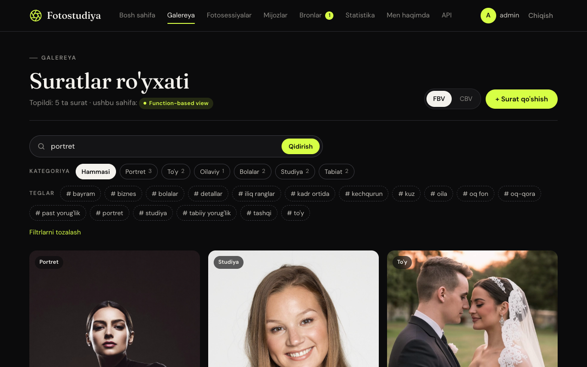
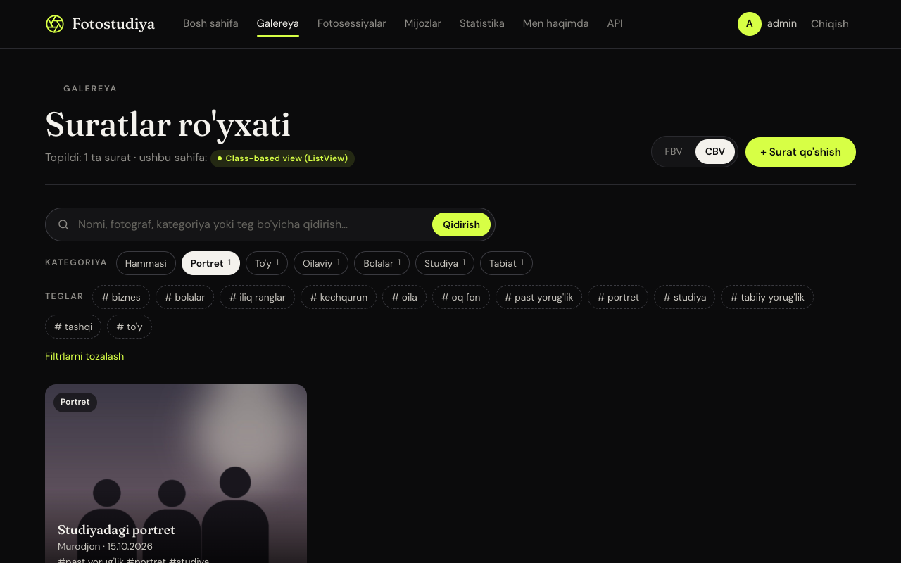

## 2. Teglar (Many-to-Many)

- [`models.py`](../photostudio/models.py) → `Tag` (nomi + avtomatik `slug`), `Photo.tags = ManyToManyField(Tag)`.
- Formada mavjud teglar chip ko'rinishidagi checkbox'lar, **"Yangi teglar"** maydoniga esa vergul bilan yangilarini yozish mumkin — `PhotoForm.save()` ularni yaratib, suratga qo'shadi.
- Galereyada `prefetch_related('tags')` — 20 ta surat bo'lsa ham teglar uchun **bitta** qo'shimcha SQL so'rov (test: `test_galereya_teglarni_prefetch_qiladi`).
- Admin: `filter_horizontal`, teg bo'yicha filtr; API: `"tags": ["portret", "studiya"]`.

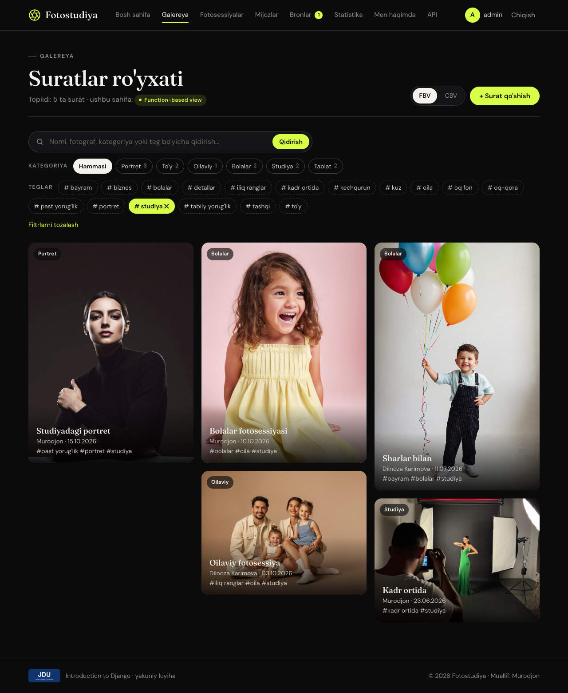
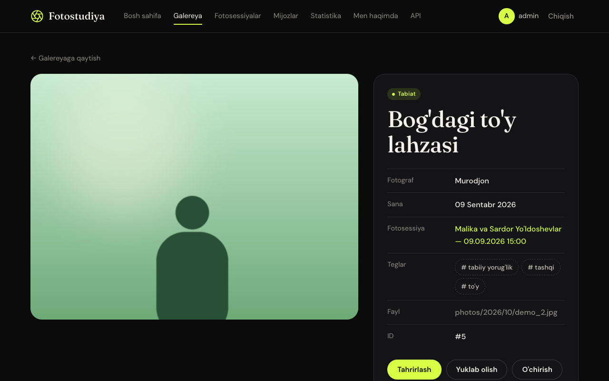
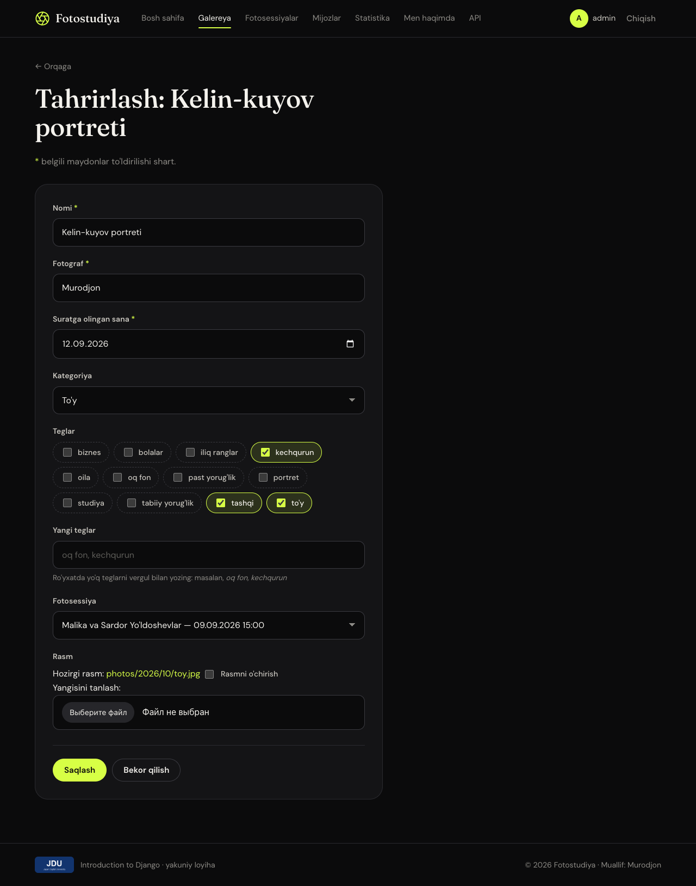

## 3. Mijoz shaxsiy kabineti (One-to-One)

- `Client.user = OneToOneField(User, related_name='client_profile')` — `request.user.client_profile` orqali mijoz topiladi.
- `/cabinet/` — salomlashish, ko'rsatkichlar, kelgusi fotosessiyalar, fotosessiyalar bo'yicha guruhlangan suratlar va **"Yuklab olish"** tugmasi.
- Mijoz faqat o'z fotosessiyasidagi suratni ochadi; begona surat → **403**.
- Xodim mijoz sahifasida **"Kabinet yaratish"** tugmasini bosib, mijozga login/parol yaratadi (`client_account_create`, `UserCreationForm` qayta ishlatilgan). Admin panelda ham `Client.user` maydoni orqali bog'lash mumkin.
- Ro'yxatdan o'zi o'tgan, lekin hali mijozga bog'lanmagan foydalanuvchi kabinetda tushuntirish xabarini ko'radi.

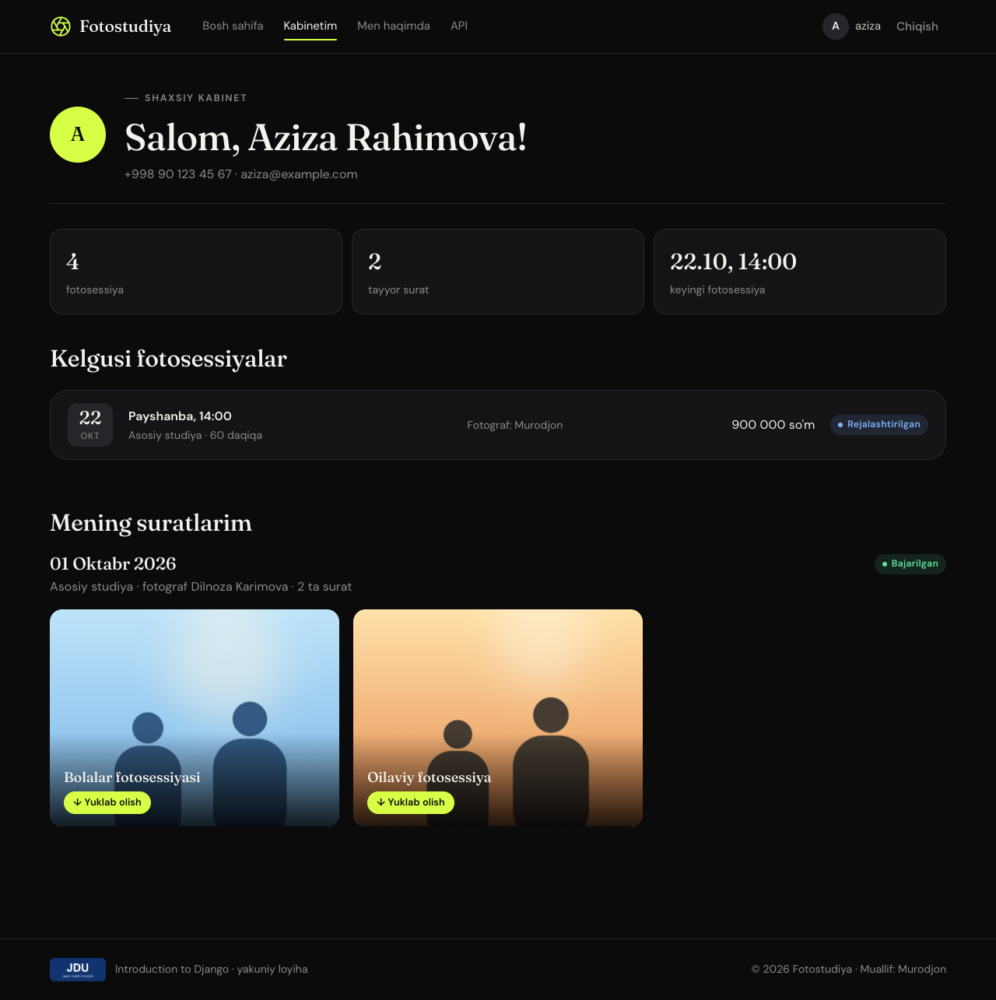
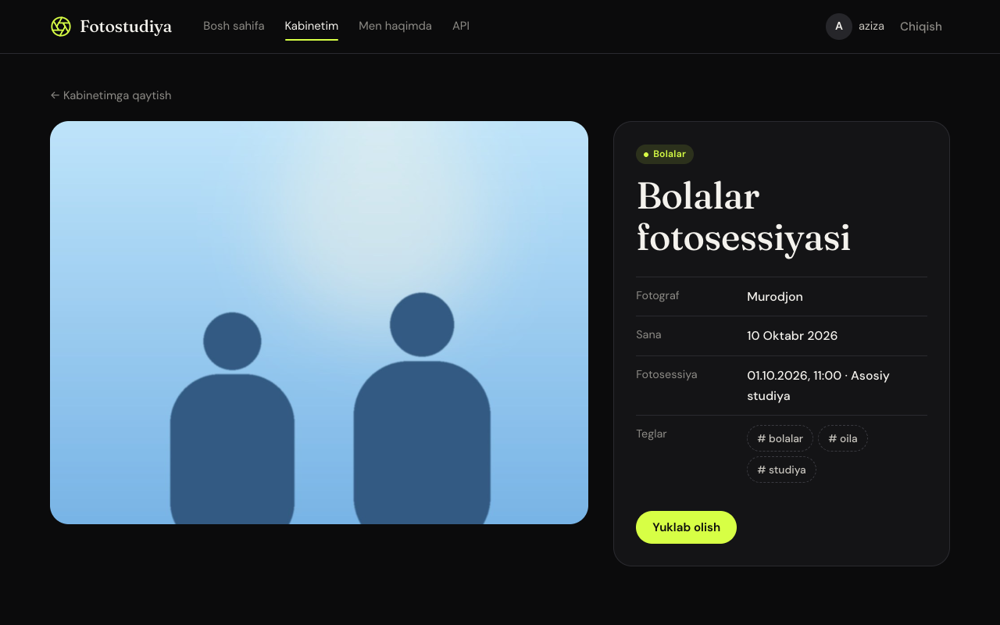
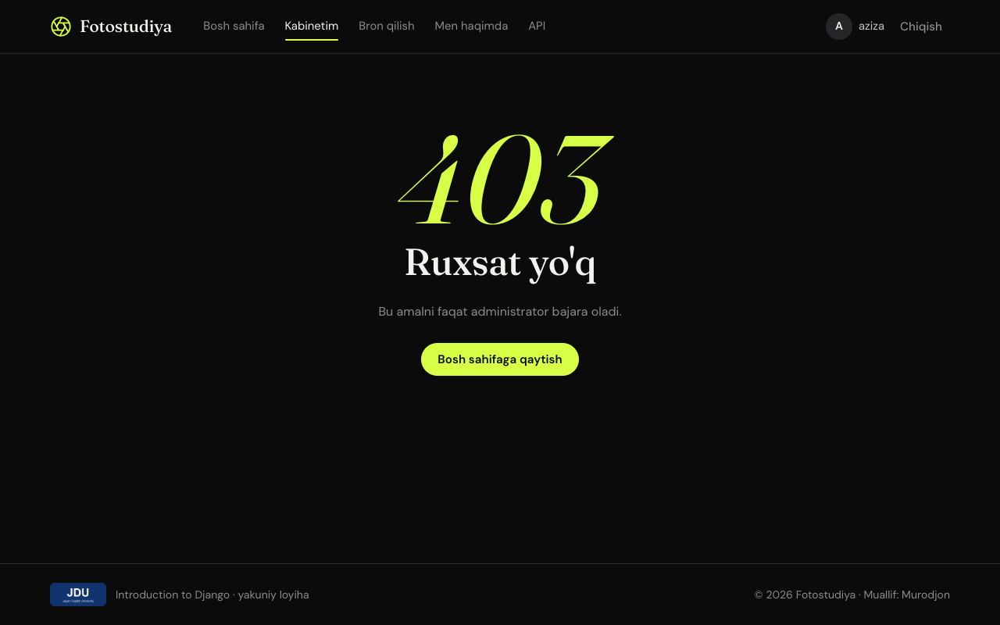

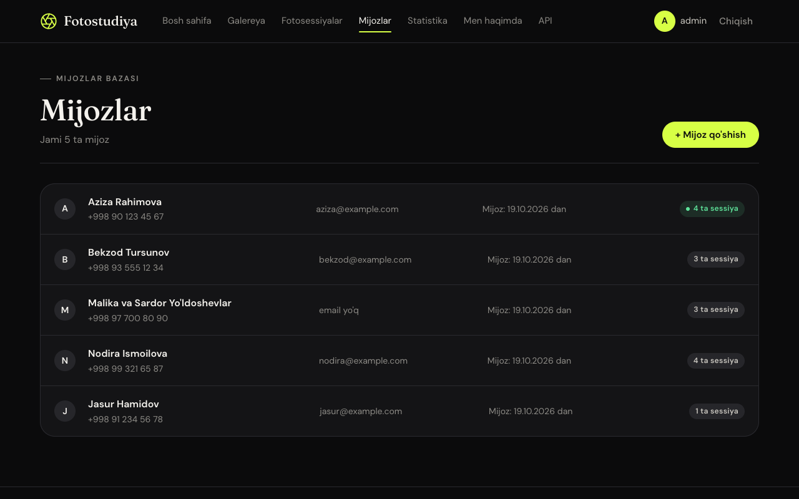
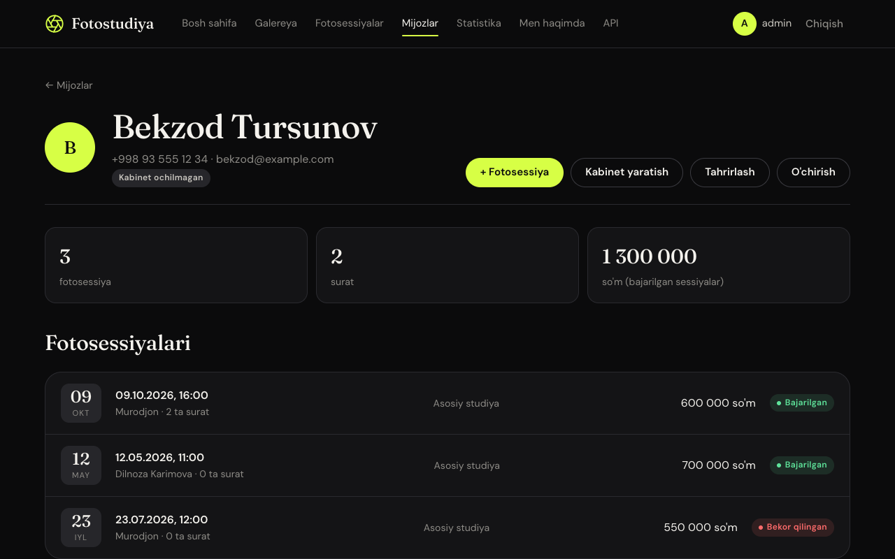
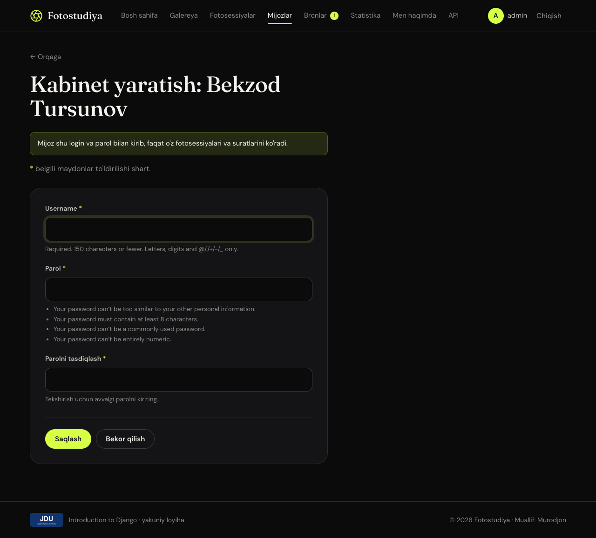
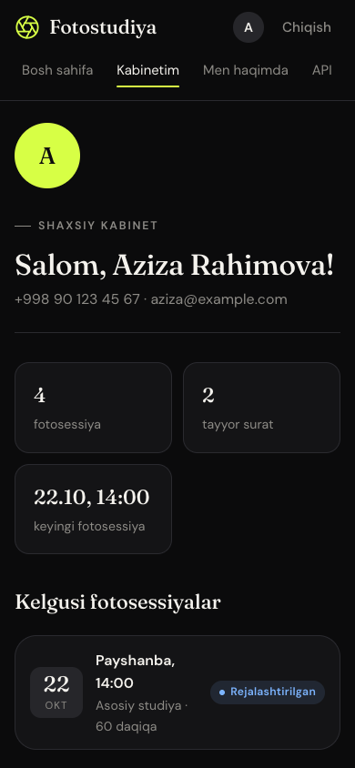

## 4. Statistika paneli

`/dashboard/` (faqat xodimlar). Hamma hisob-kitob ORM orqali, bazada bajariladi — [`views.py`](../photostudio/views.py) → `dashboard()`:

| Blok | ORM |
|---|---|
| Jami / shu oy daromad, o'rtacha narx | `aggregate(Sum, Avg, Count)` + `Coalesce` (bo'sh bo'lsa 0) |
| Oylik daromad (6 oy) | `annotate(month=TruncMonth('scheduled_at')).values('month').annotate(Sum('price'))` — bitta `GROUP BY` |
| Fotograflar reytingi | `values('photographer').annotate(Count, Sum(filter=Q(status='done')))` |
| Kategoriyalar, teglar | `annotate(Count('photos'))` |
| Sessiya holatlari | `values('status').annotate(Count('id'))` |
| Eng faol mijozlar | `Sum('sessions__price', filter=Q(...))` — bog'liq model bo'yicha yig'indi |

Grafiklar JavaScript'siz, server tomonida HTML/CSS bilan chiziladi (internetsiz ham ishlaydi). Har bir ustun ustiga sichqoncha olib borilsa yoki Tab bilan tanlansa, aniq qiymat ko'rinadi. "Jadval ko'rinishi" esa raqamlarni jadval qilib beradi.
Daromad faqat **bajarilgan** sessiyalardan hisoblanadi (test: `test_statistika_faqat_bajarilgan_sessiyalarni_hisoblaydi`).

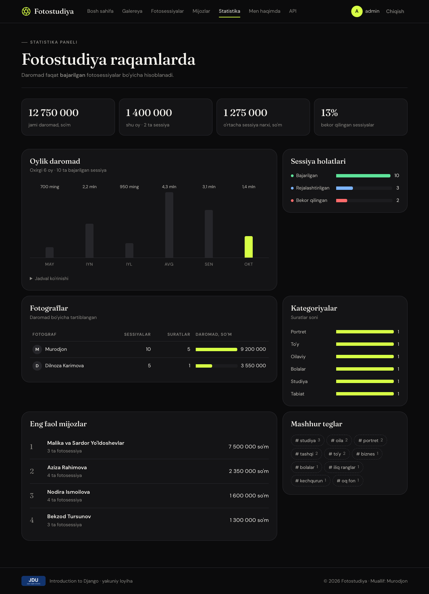

---

## 5. Onlayn bron so'rovi

- Model: [`BookingRequest`](../photostudio/models.py) — ism, telefon, email, fotosessiya turi, qulay vaqt, izoh, holat (Yangi / Tasdiqlangan / Rad etilgan), studiya javobi.
  Tasdiqlanganda yaratilgan fotosessiya bilan **One-to-One** (`booking.session`).
- **Mehmon yoki mijoz** `/book/` sahifasida so'rov yuboradi. Mijozning ismi va telefoni profilidan avtomatik to'ldiriladi. O'tib ketgan yoki 2 soatdan yaqin vaqtni tanlab bo'lmaydi.
- **Xodim** menyudagi "Bronlar" yonida yangi so'rovlar sonini ko'radi (`context_processors.py`). `/bookings/` sahifasida so'rovlarni holat bo'yicha saralaydi.
- So'rov sahifasida ikkita forma bor: **tasdiqlash** (fotograf, vaqt, narx, mijozga xabar) va **rad etish** (sabab).
- Tasdiqlash (`approve_booking`, `transaction.atomic` ichida):
  1. telefon raqam bo'yicha **mavjud mijozni topadi** (probellarga qaramay), topilmasa yangisini yaratadi;
  2. so'rov akkauntdan yuborilgan bo'lsa, **mijoz kabinetini avtomatik bog'laydi**;
  3. rejalashtirilgan **fotosessiya yaratadi** va so'rovni unga bog'laydi.
- Mijoz kabinetida "Mening bron so'rovlarim" bo'limi bor: har bir so'rovning holati va studiya javobi.

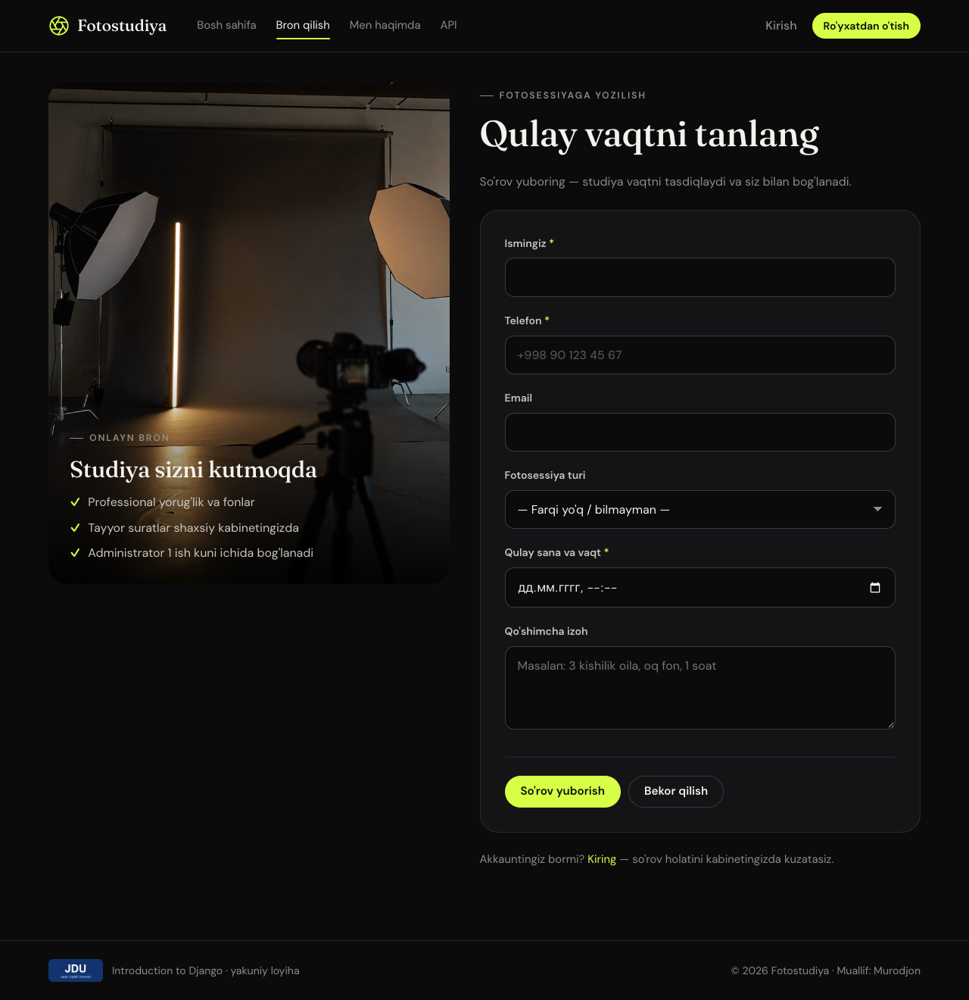
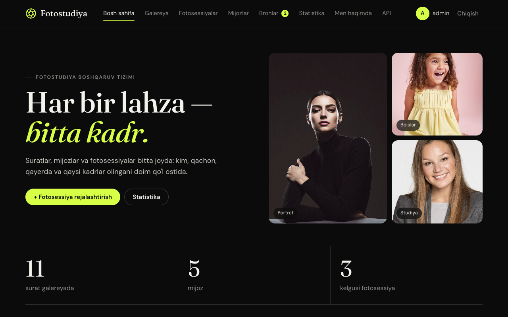
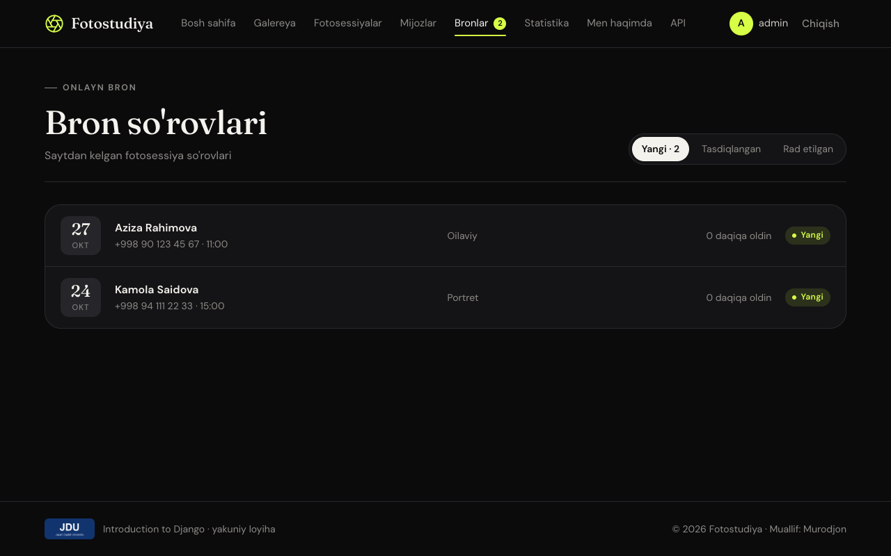
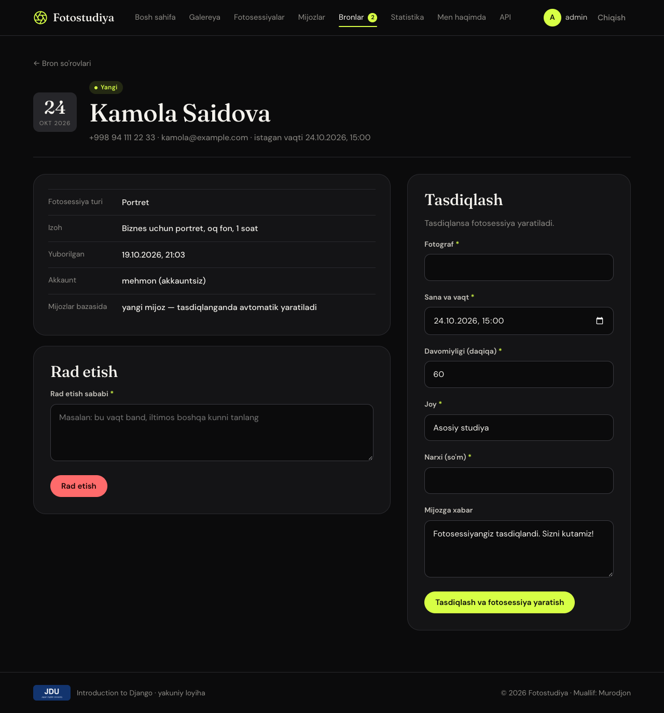
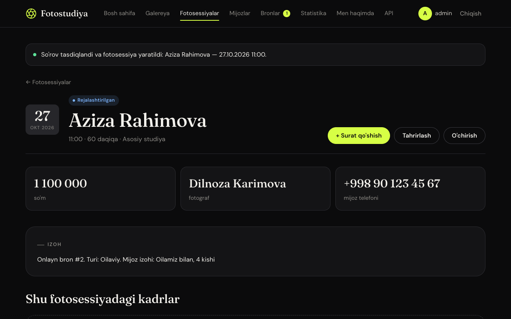
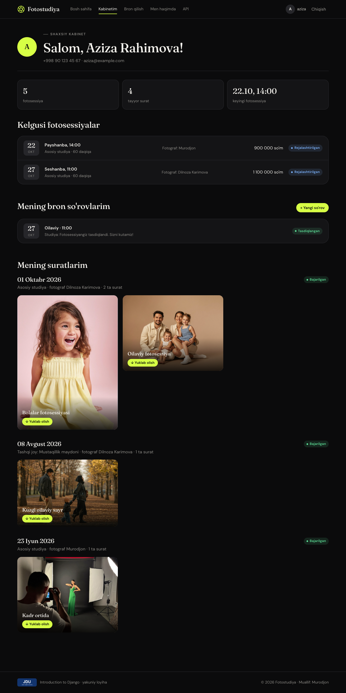

## 6. Internetga joylash (deploy)

To'liq qadamma-qadam qo'llanma: [**DEPLOY.md**](../DEPLOY.md) (PythonAnywhere — tavsiya etiladi, Render — avtomatik).

- [`config/env.py`](../config/env.py) — `.env` faylni o'qiydi; `SECRET_KEY`, `DEBUG`, `ALLOWED_HOSTS`, `CSRF_TRUSTED_ORIGINS` endi kodda emas.
- `DEBUG=False` bo'lganda avtomatik yoqiladi: WhiteNoise (siqilgan, hash nomli static fayllar), HTTPS cookie'lar, HSTS, SMTP email.
  Maxfiy kalit berilmasa, sayt umuman ishga tushmaydi (`ImproperlyConfigured`).
- `render.yaml` va `build.sh` — Render'da bir tugma bilan deploy qilish uchun.
- Kompyuterda server rejimi gunicorn bilan sinab ko'rildi: barcha sahifalar 200, CSS gzip bilan siqilib beriladi, media fayllar ochiladi —
  [`terminal/deploy_sinov.txt`](terminal/deploy_sinov.txt).

> ⚠️ Oxirgi qadam sizda qoladi: PythonAnywhere'da akkaunt ochish (loyiha GitHub'da: <https://github.com/murodjon-coder/djangoproject>).

## 7. AI bilan yaratilgan suratlar

Galereyadagi siluetli namuna rasmlar o'rniga **Higgsfield Soul 2.0** modeli bilan 11 ta realistik foto yaratildi
(to'y, nikoh uzuklari, oilaviy, kuzgi sayr, bolalar, portret, oq-qora portret, biznes, kadr ortida). Sayt bezagi uchun yana 3 ta rasm qo'shildi:
studiya interyeri (bron sahifasi), "kadr ortida" (kirish sahifasi) va bog' (ro'yxatdan o'tish sahifasi).

- Fayllar: [`photostudio/demo_photos/`](../photostudio/demo_photos/) (git'da, ~2 MB) — `seed_demo` ularni galereyaga joylaydi, shuning uchun serverda ham xuddi shu ko'rinish bo'ladi.
- Sarflangan: **14 ta rasm, 1,68 Higgsfield krediti** (2 tasi qayta yaratildi: ochiq kiyimli variantlar dars uchun mos emas edi).
- Suratlardagi odamlar haqiqiy emas.

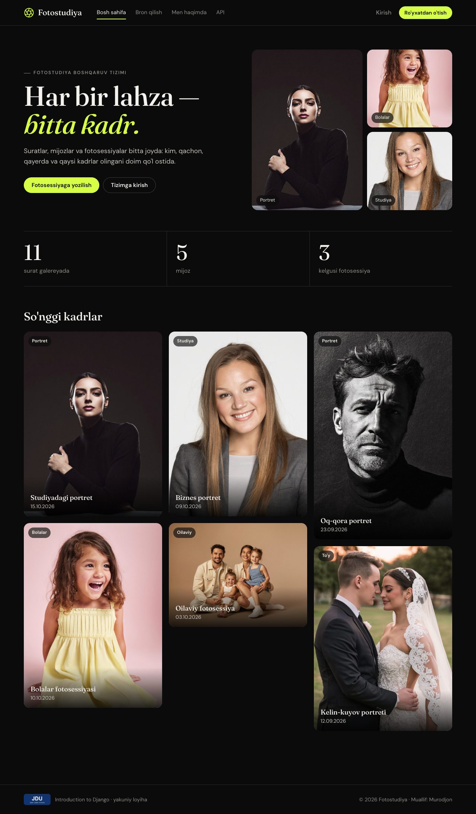
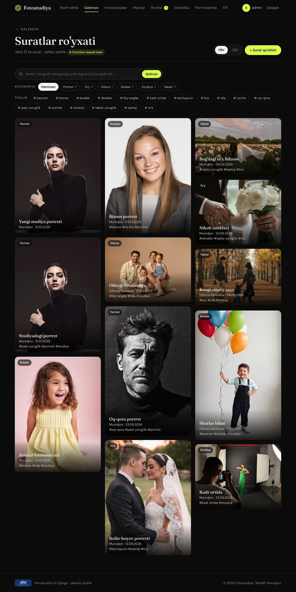

---

## Testlar

[`tests/test_features.py`](../photostudio/tests/test_features.py) — 28 ta, [`tests/test_booking.py`](../photostudio/tests/test_booking.py) — 8 ta yangi test. `test_features.py`: qidiruv, filtrlar, sahifalash (FBV va CBV), teg slug'lari, formada yangi teglar, N+1 yo'qligi, mijoz izolyatsiyasi (o'z/begona surat), rollar bo'yicha 403, login'dan keyingi yo'naltirish, kabinet yaratish, statistika hisob-kitobi.

```
$ pytest
============================== 74 passed ==============================
```

## Darsda qanday ko'rsatish (3 daqiqa)

1. `admin` bilan kiring → **Galereya**: qidiruvga `portret` yozing, keyin `# studiya` tegini bosing.
2. **Statistika** → oylik daromad grafigi, ustun ustiga sichqonchani olib boring.
3. **Mijozlar** → Bekzod Tursunov → **Kabinet yaratish** (yoki tayyor `aziza` akkauntidan foydalaning).
4. Chiqing → `aziza` / `Mijoz2026` bilan kiring → avtomatik **kabinet** ochiladi; suratni yuklab oling.
5. Manzilga `/photos/` yozing → 403: mijoz boshqalarning ma'lumotini ko'ra olmaydi.
6. Chiqing → mehmon sifatida **Bron qilish** → so'rov yuboring → `admin` bilan kirib, **Bronlar** dagi yangi so'rovni tasdiqlang.
