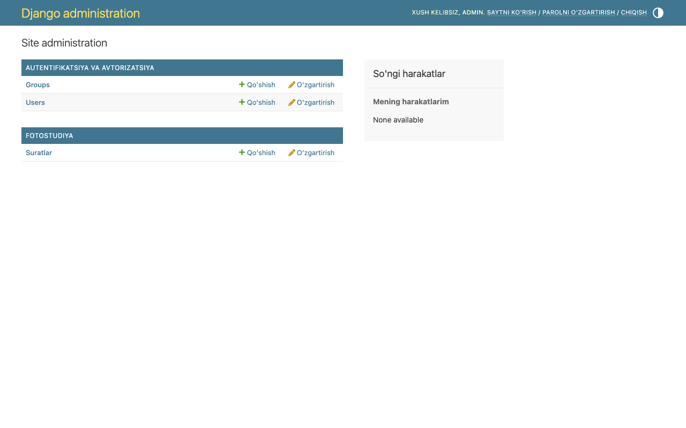
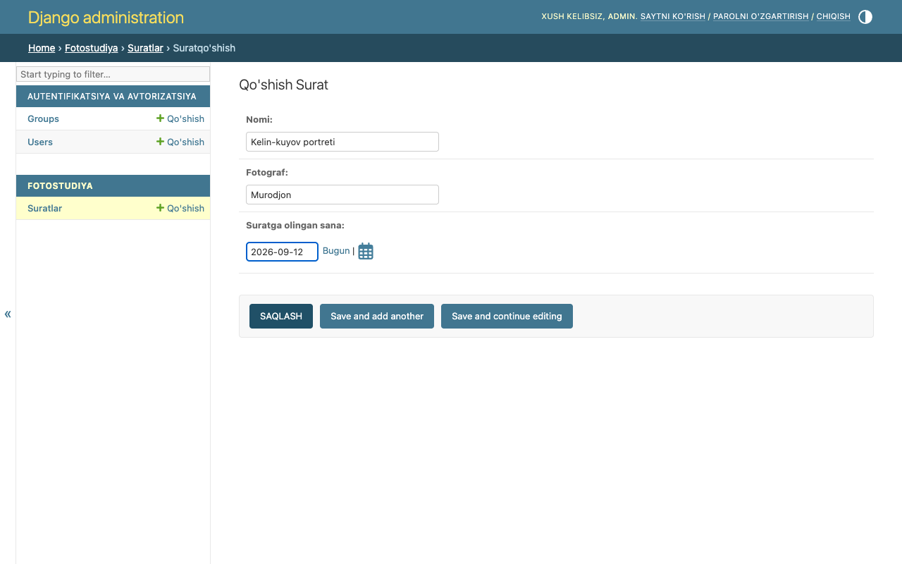
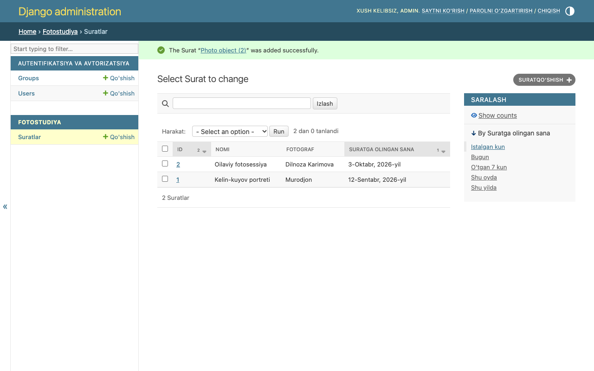

# 3-hafta — Django modellari

**Holat:** ✅ bajarildi · **Commit:** `d84e81f`

Variant 19: model **`Photo`**, maydonlar **`title`, `photographer`, `date`**.

---

## Nazariy qism

### 1-topshiriq — Django ORM

ORM (Object-Relational Mapping) — ma'lumotlar bazasi bilan SQL yozmasdan, oddiy Python klass va obyektlar orqali ishlash usuli.
Masalan, `Photo.objects.filter(photographer='Murodjon')` yozsam, Django uni o'zi SQL `SELECT` so'roviga aylantiradi.
Bu kodni qisqa va xavfsiz qiladi (SQL injection'dan himoya) va bazani SQLite'dan PostgreSQL'ga almashtirganda kodni o'zgartirish shart bo'lmaydi.

### 2-topshiriq — Migratsiyalar

`makemigrations` — `models.py` dagi o'zgarishlarni o'qib, `migrations/` papkasida migratsiya faylini (bazani qanday o'zgartirish "rejasi"ni) yaratadi. Bu bosqichda baza hali o'zgarmaydi.
`migrate` — shu migratsiya fayllarini bazaga qo'llaydi, ya'ni jadval yaratadi yoki ustun qo'shadi.
Qisqasi: `makemigrations` — rejani yozadi, `migrate` — rejani bajaradi.

---

## Amaliy qism

### 3-topshiriq — Model yaratish

[`photostudio/models.py:120`](../photostudio/models.py) (3-haftadagi asl ko'rinishi):

```python
class Photo(models.Model):
    """Fotostudiyada olingan surat (3-hafta)."""

    title = models.CharField("Nomi", max_length=200)
    photographer = models.CharField("Fotograf", max_length=100)
    date = models.DateField("Suratga olingan sana")

    class Meta:
        verbose_name = "Surat"
        verbose_name_plural = "Suratlar"
        ordering = ['-date', '-id']
```

Keyingi haftalarda bu modelga `category` (7-hafta), `__str__` (7-hafta), `image` (11-hafta) va `session` (14-hafta) qo'shildi.

### 4-topshiriq — Migratsiya qilish

```bash
python manage.py makemigrations photostudio
python manage.py migrate
```

Yaratilgan fayl: [`photostudio/migrations/0001_initial.py`](../photostudio/migrations/0001_initial.py).
To'liq terminal chiqishi: [`terminal/week03_migrate.txt`](terminal/week03_migrate.txt)

### 5-topshiriq — Admin panelda boshqarish

[`photostudio/admin.py`](../photostudio/admin.py) — model `@admin.register(Photo)` bilan ro'yxatdan o'tkazilgan
(`list_display`, `search_fields`, `list_filter` bilan).

Superuser yaratildi va **admin panel orqali 2 ta yozuv qo'shildi**:
1. "Kelin-kuyov portreti" — Murodjon — 12.09.2026
2. "Oilaviy fotosessiya" — Dilnoza Karimova — 03.10.2026

---

## Darsda qanday ko'rsatish

1. `python manage.py runserver` → brauzerda <http://127.0.0.1:8000/admin/>
2. Login: **admin** / **Studio2026!**
3. "Fotostudiya → Suratlar" bo'limini oching va qo'shilgan yozuvlarni ko'rsating.
4. "Qo'shish" tugmasi orqali yangi yozuv qo'shib ko'rsatish mumkin.

## Natija

Admin bosh sahifasi — "Fotostudiya" bo'limi:



Admin orqali yozuv qo'shish:



2 ta yozuv qo'shilgandan keyin (e'tibor bering: xabarda **"Photo object (2)"** deb yozilgan, chunki `__str__` hali yo'q — u 7-haftada qo'shiladi):


