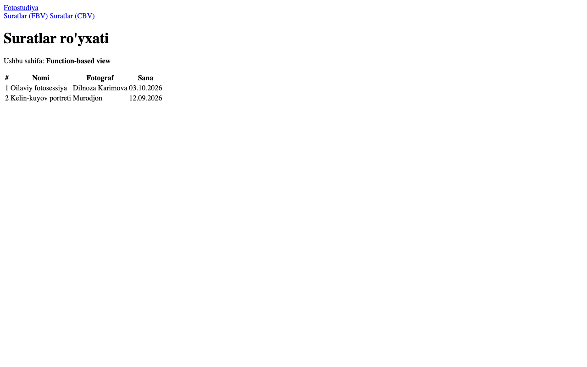
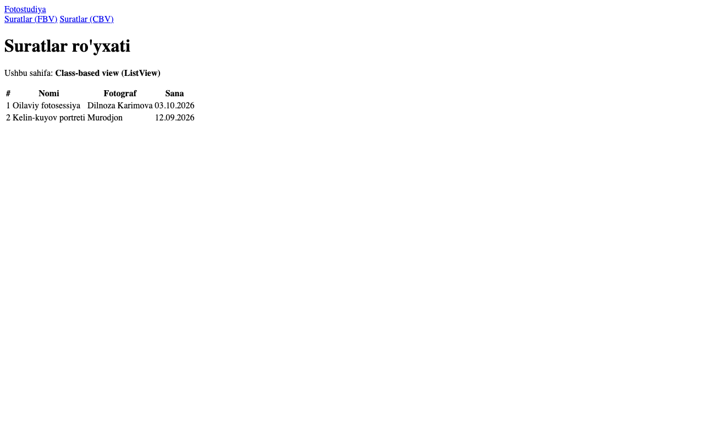
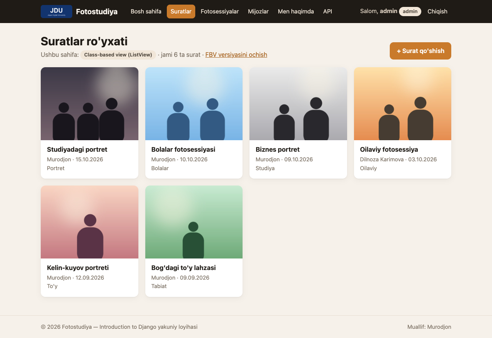

# 4-hafta — Django Views va Templates

**Holat:** ✅ bajarildi · **Commit:** `d0501e6`

---

## Nazariy qism

### 1-topshiriq — View va Template

**View** — so'rovni qabul qilib, kerakli ma'lumotni (masalan, bazadan suratlar ro'yxatini) tayyorlaydigan va javob qaytaradigan Python funksiya yoki klass.
**Template** — shu ma'lumotni foydalanuvchiga ko'rsatadigan HTML sahifa shabloni (`{{ }}` va `` teglari bilan).
Ya'ni view "nima ko'rsatish"ni, template esa "qanday ko'rsatish"ni hal qiladi.

### 2-topshiriq — FBV va CBV

**Function-based view (FBV)** — oddiy Python funksiya: `request` oladi, hamma narsani o'zingiz yozasiz, tushunish oson.
**Class-based view (CBV)** — klass ko'rinishidagi view; Django'ning tayyor klasslari (`ListView`, `DetailView`, `CreateView`...) ko'p ishni o'zi qiladi, shuning uchun kod qisqaroq bo'ladi.
FBV oddiy va moslashuvchan, CBV esa takrorlanuvchi ishlar (ro'yxat, detail, CRUD) uchun qulay.

---

## Amaliy qism

### 3-topshiriq — Function-based view

[`photostudio/views.py:60`](../photostudio/views.py):

```python
@login_required                       # 8-haftada qo'shilgan
def photo_list(request):
    """4-hafta: function-based view — barcha suratlar ro'yxati."""
    photos = Photo.objects.select_related('category')   # 4-haftada: Photo.objects.all()
    return render(request, 'photostudio/photo_list.html', {
        'photos': photos,
        'view_type': 'Function-based view',
    })
```

### 4-topshiriq — Template va ``

[`photostudio/templates/photostudio/photo_list.html`](../photostudio/templates/photostudio/photo_list.html):

```django

    <a class="card" href="">
        ...
        <h3>{{ photo.title }}</h3>
        <p class="card-meta">{{ photo.photographer }} &middot; {{ photo.date|date:"d.m.Y" }}</p>
    </a>

    <p>Hozircha suratlar yo'q.</p>

```

Barcha sahifalar umumiy [`templates/base.html`](../templates/base.html) dan meros oladi (``).

### 5-topshiriq — ListView bilan qayta yozish

[`photostudio/views.py:71`](../photostudio/views.py):

```python
class PhotoListView(LoginRequiredMixin, ListView):
    """4-hafta: xuddi shu ro'yxat, lekin class-based view (ListView) bilan."""

    queryset = Photo.objects.select_related('category')
    template_name = 'photostudio/photo_list.html'
    context_object_name = 'photos'
    extra_context = {'view_type': 'Class-based view (ListView)'}
```

Ikkala view **bitta template**'dan foydalanadi. Sahifadagi belgi (badge) qaysi view ishlayotganini ko'rsatadi.

URL'lar — [`photostudio/urls.py:12-13`](../photostudio/urls.py):

```python
path('photos/', views.photo_list, name='photo_list'),                      # FBV
path('photos/cbv/', views.PhotoListView.as_view(), name='photo_list_cbv'),  # CBV
```

---

## Darsda qanday ko'rsatish

1. Tizimga kiring (8-haftadan beri ro'yxat himoyalangan): **admin / Studio2026!**
2. <http://127.0.0.1:8000/photos/> — sahifada **"Function-based view"** yozuvi bor.
3. <http://127.0.0.1:8000/photos/cbv/> (yoki sahifadagi "CBV versiyasini ochish" havolasi) — **"Class-based view (ListView)"**.
4. Ikkalasida ham bir xil ro'yxat chiqishini ko'rsating, so'ng `views.py` da ikkala kodni yonma-yon ko'rsating.

## Natija

4-haftadagi ko'rinish (CSS 10-haftada qo'shilgan):




Yakuniy ko'rinish (CBV):


