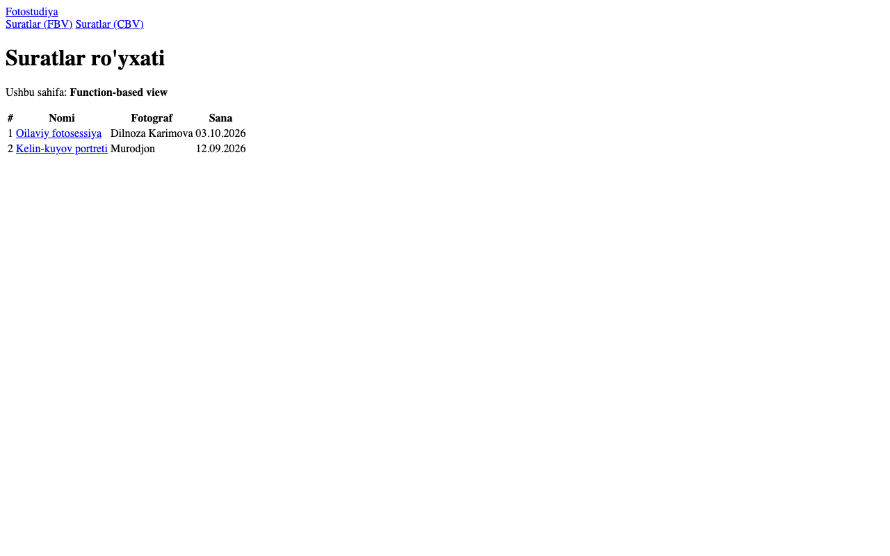
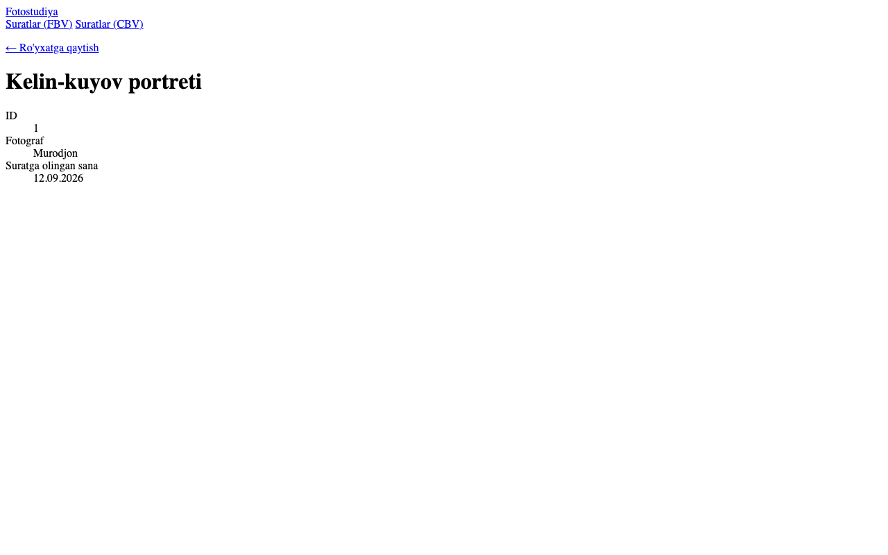

# 5-hafta — Django URLs va Routing

**Holat:** ✅ bajarildi · **Commit:** `90db2ac`

---

## Nazariy qism

### 1-topshiriq — Path converter

Path converter — URL ichidagi o'zgaruvchan qismni qanday turdagi qiymat sifatida qabul qilishni bildiradi, masalan `<int:id>`, `<str:name>`, `<slug:slug>`.
U ikki ishni qiladi: noto'g'ri qiymatni o'tkazmaydi (`/photos/abc/` → 404) va qiymatni kerakli turga o'girib view'ga beradi (`id` — `int` bo'lib keladi).

### 2-topshiriq — Dinamik URL

Oddiy URL har doim bitta sahifani ochadi: `photos/` — har doim ro'yxat.
Dinamik URL'da o'zgaruvchan qism bo'ladi: `photos/<int:id>/` — `/photos/1/` 1-suratni, `/photos/2/` 2-suratni ochadi.
Shunday qilib, bitta view va bitta URL pattern minglab obyekt sahifalariga xizmat qiladi.

---

## Amaliy qism

### 3-topshiriq — Ro'yxat sahifasi uchun URL

[`photostudio/urls.py:15`](../photostudio/urls.py):

```python
app_name = 'photostudio'

urlpatterns = [
    path('photos/', views.photo_list, name='photo_list'),
    ...
]
```

Ilova URL'lari loyihaga [`config/urls.py`](../config/urls.py) da `path('', include('photostudio.urls'))` orqali ulangan.

### 4-topshiriq — Dinamik URL

[`photostudio/urls.py:18`](../photostudio/urls.py):

```python
path('photos/<int:id>/', views.photo_detail, name='photo_detail'),
```

[`photostudio/views.py:141`](../photostudio/views.py):

```python
@login_required
def photo_detail(request, id):
    """5-hafta: bitta suratni ko'rsatuvchi view (dinamik URL: photos/<int:id>/)."""
    photo = get_object_or_404(Photo.objects.select_related('category', 'session__client'), id=id)
    return render(request, 'photostudio/photo_detail.html', {'photo': photo})
```

`get_object_or_404` — agar bunday `id` li surat bo'lmasa, xato o'rniga 404 sahifasini qaytaradi.

| Manzil | Natija |
|---|---|
| `/photos/1/` | 200 — 1-surat |
| `/photos/999/` | 404 — bunday surat yo'q |
| `/photos/abc/` | 404 — `int` converter harfni qabul qilmaydi |

### 5-topshiriq — `` tegi

[`photo_list.html`](../photostudio/templates/photostudio/photo_list.html) — har bir surat detail sahifaga havola:

```django
<a class="card" href="">
```

`base.html` dagi menyu ham `` bilan yozilgan (masalan ``), ya'ni URL o'zgarsa ham havolalar buzilmaydi.

---

## Darsda qanday ko'rsatish

1. <http://127.0.0.1:8000/photos/> ni oching.
2. Istalgan surat kartochkasini bosing → manzil `/photos/<id>/` ga o'zgaradi va detail sahifa ochiladi.
3. Manzil satriga `/photos/999/` yozib, 404 chiqishini ko'rsating.
4. `urls.py` dagi `<int:id>` va template'dagi `` ni ko'rsating.

## Natija




Yakuniy detail sahifa (rasm bilan, 11–14-haftalardan keyin):


