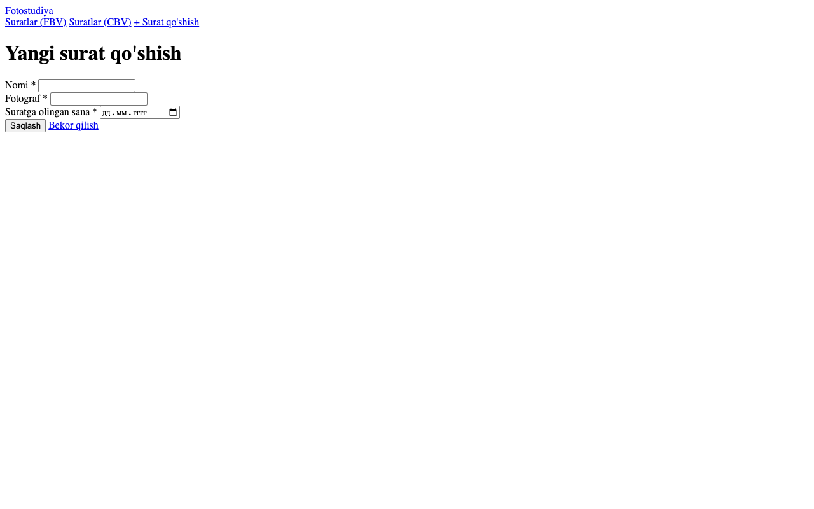
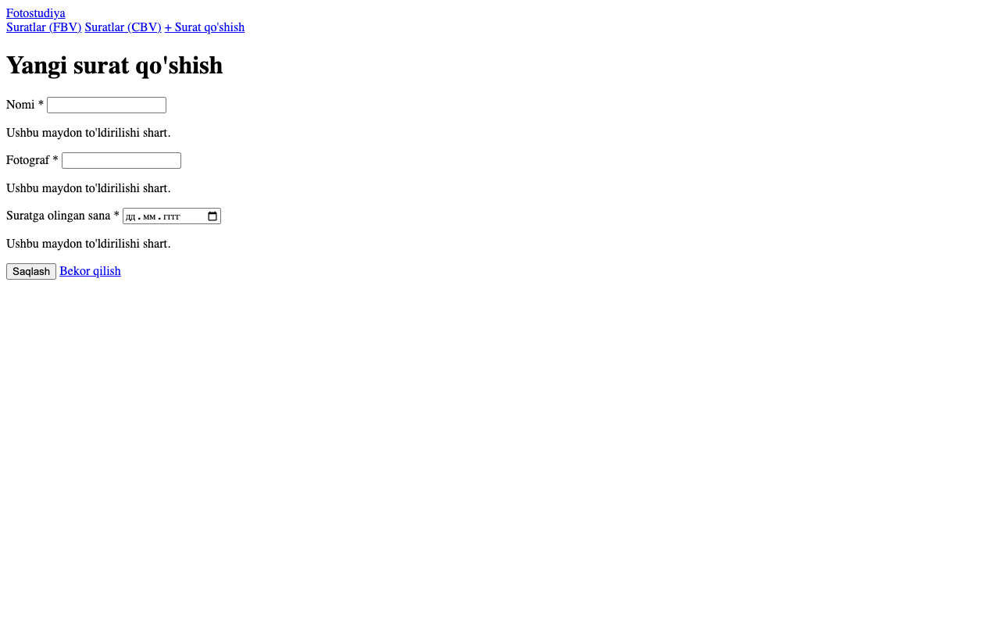
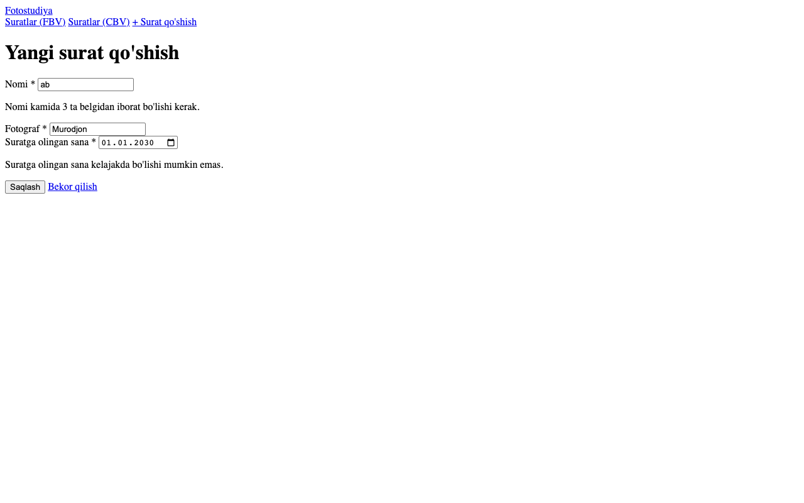
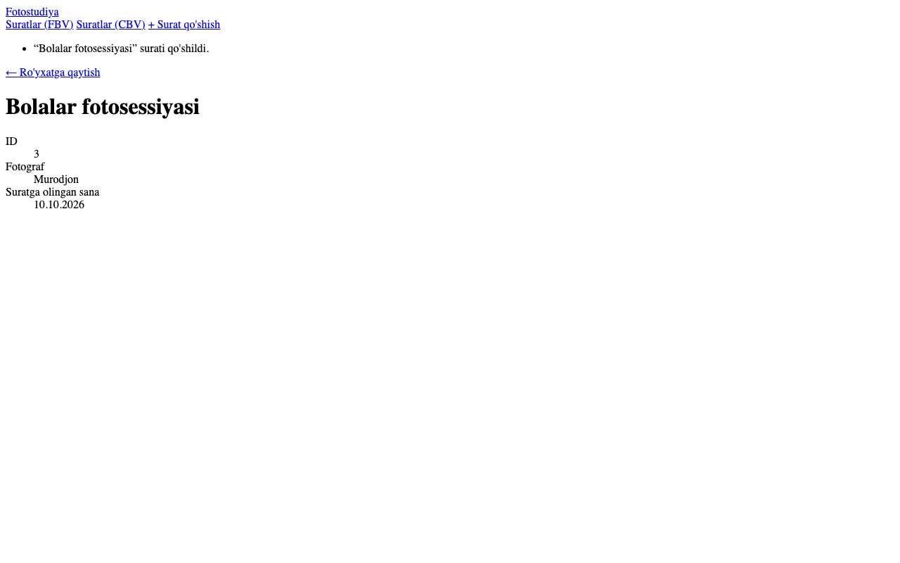

# 6-hafta — Django Formalar

**Holat:** ✅ bajarildi · **Commit:** `1dcfb61`

---

## Nazariy qism

### 1-topshiriq — Forms moduli

Django forms moduli HTML formani avtomatik yaratadi, foydalanuvchi yuborgan ma'lumotni tekshiradi (validatsiya) va xatolarni ko'rsatadi.
`ModelForm` esa formani to'g'ridan-to'g'ri modeldan yasaydi va `form.save()` bilan bazaga saqlaydi.
Shu tufayli har bir maydonni qo'lda tekshirish shart emas, kod xavfsiz va qisqa bo'ladi.

### 2-topshiriq — GET va POST

**GET** — ma'lumot olish uchun: formani birinchi marta ochganda bo'sh forma ko'rsatiladi; parametrlar URL'da ko'rinadi (`?status=planned`).
**POST** — ma'lumot yuborish uchun: "Saqlash" bosilganda forma ma'lumotlari so'rov tanasida (body) yuboriladi va URL'da ko'rinmaydi.
Bazani o'zgartiradigan amallar (qo'shish, tahrirlash, o'chirish) doim POST bilan, CSRF token bilan himoyalangan holda bajariladi.

---

## Amaliy qism

### 3-topshiriq — Forma klassi

[`photostudio/forms.py:17`](../photostudio/forms.py):

```python
class PhotoForm(forms.ModelForm):
    class Meta:
        model = Photo
        fields = ['title', 'photographer', 'date', 'category', 'session', 'image']   # 6-haftada: title, photographer, date
        widgets = {'date': forms.DateInput(attrs={'type': 'date'}, format='%Y-%m-%d'), ...}

    def clean_title(self):
        title = self.cleaned_data['title'].strip()
        if len(title) < 3:
            raise forms.ValidationError("Nomi kamida 3 ta belgidan iborat bo'lishi kerak.")
        return title

    def clean_date(self):
        date = self.cleaned_data['date']
        if date > timezone.localdate():
            raise forms.ValidationError("Suratga olingan sana kelajakda bo'lishi mumkin emas.")
        return date
```

### 4-topshiriq — View'da qayta ishlash (`is_valid()`)

[`photostudio/views.py:155`](../photostudio/views.py):

```python
@login_required
def photo_create(request):
    if request.method == 'POST':
        form = PhotoForm(request.POST, request.FILES)      # request.FILES — 11-hafta
        if form.is_valid():
            photo = form.save()
            messages.success(request, f"“{photo.title}” surati qo'shildi.")
            return redirect('photostudio:photo_detail', id=photo.id)
    else:
        form = PhotoForm()                                  # GET — bo'sh forma
    return render(request, 'photostudio/form.html', {...})
```

URL: `photos/add/` → [`photostudio/urls.py:17`](../photostudio/urls.py)

### 5-topshiriq — Xatolikni ko'rsatish

- [`templates/_form_fields.html`](../templates/_form_fields.html) — har bir maydonni `{{ field.errors }}` bilan chiqaradi, xatoli maydon qizil bo'ladi.
- [`photostudio/templates/photostudio/form.html`](../photostudio/templates/photostudio/form.html) — forma, ``, `novalidate` (brauzer tekshiruvini o'chirib, server tekshiruvini ko'rsatish uchun).

| Kiritilgan ma'lumot | Natija |
|---|---|
| Hammasi bo'sh | "Ushbu maydon to'ldirilishi shart." |
| Nomi: `ab` | "Nomi kamida 3 ta belgidan iborat bo'lishi kerak." |
| Sana: `01.01.2030` | "Suratga olingan sana kelajakda bo'lishi mumkin emas." |
| To'g'ri ma'lumot | Saqlanadi → detail sahifa + yashil xabar |

---

## Darsda qanday ko'rsatish

1. Tizimga kiring → menyudan "Suratlar" → "+ Surat qo'shish" (<http://127.0.0.1:8000/photos/add/>).
2. Hech narsa yozmay "Saqlash" ni bosing → har bir maydon tagida xato.
3. Nomiga `ab`, sanaga kelajakdagi sanani yozing → maxsus xato xabarlari.
4. To'g'ri ma'lumot va rasm bilan saqlang → yangi surat sahifasi ochiladi.
5. `forms.py` dagi `clean_title` / `clean_date` va `views.py` dagi `is_valid()` ni ko'rsating.

## Natija

6-haftadagi ko'rinish (CSS'siz):






CSS bilan (10-haftadan keyin):


