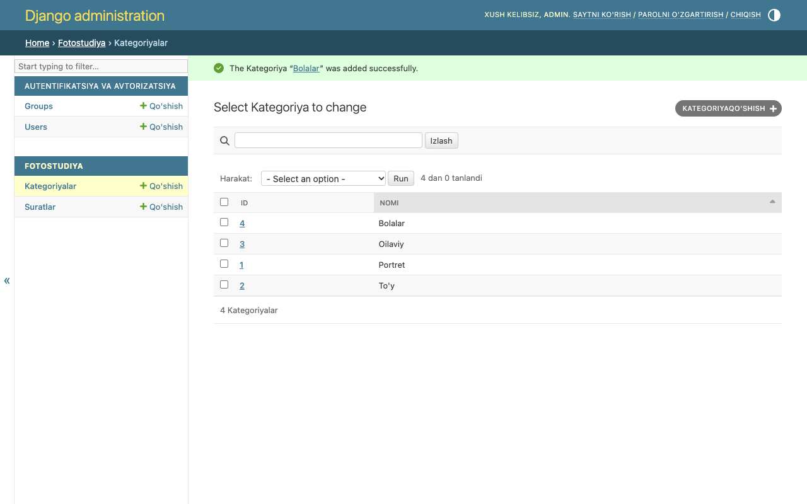
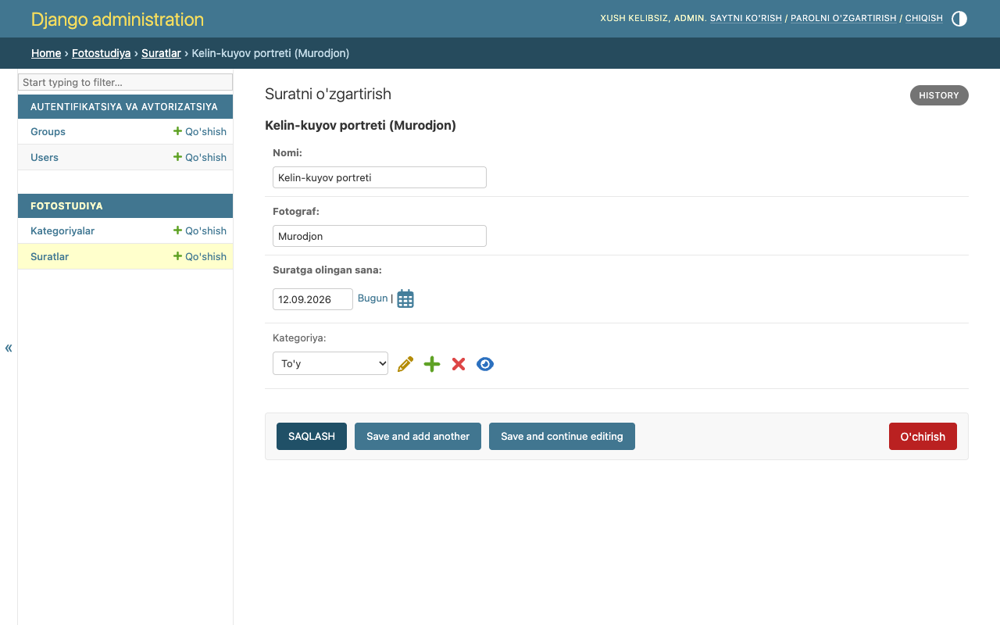
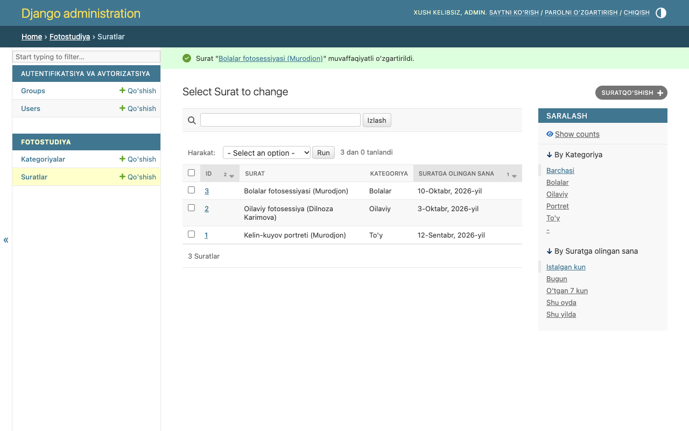

# 7-hafta — Model bog'lanishlari va optimizatsiya

**Holat:** ✅ bajarildi · **Commit:** `adf43fe`

---

## Nazariy qism

### 1-topshiriq — Model bog'lanishlari

- **One-to-One** (`OneToOneField`) — bitta yozuvga faqat bitta yozuv mos keladi. Misol: har bir foydalanuvchining bitta profili bor.
- **One-to-Many** (`ForeignKey`) — bitta yozuvga ko'p yozuv bog'lanadi. Misol: bitta kategoriyada ko'p surat (`Photo.category`), bitta mijozning ko'p fotosessiyasi (`Session.client`).
- **Many-to-Many** (`ManyToManyField`) — ikki tomonda ham ko'p. Misol: bitta suratda bir nechta teg, bitta teg esa ko'p suratda bo'lishi mumkin.

### 2-topshiriq — `select_related`

Ro'yxatda har bir suratning kategoriya nomini chiqarsak, Django avval suratlarni oladi, keyin **har bir surat uchun alohida** kategoriya so'rovini yuboradi. Buni **"N+1 muammosi"** deyishadi.
`select_related('category')` bog'liq jadvalni SQL `JOIN` orqali **bitta so'rovda** olib keladi, shuning uchun sahifa tezroq ishlaydi.
U `ForeignKey` va `OneToOne` bog'lanishlar uchun ishlaydi.

---

## Amaliy qism

### 3-topshiriq — Bog'liq model + ForeignKey

[`photostudio/models.py:7`](../photostudio/models.py) — yangi model:

```python
class Category(models.Model):
    name = models.CharField("Nomi", max_length=100, unique=True)

    def __str__(self):
        return self.name
```

[`photostudio/models.py:92`](../photostudio/models.py) — `Photo` ga ForeignKey:

```python
category = models.ForeignKey(
    Category,
    on_delete=models.SET_NULL,   # kategoriya o'chirilsa, surat qoladi (category = NULL)
    null=True, blank=True,
    related_name='photos',       # category.photos.all()
    verbose_name="Kategoriya",
)
```

Migratsiya: [`0002_category_photo_category.py`](../photostudio/migrations/0002_category_photo_category.py).
Admin orqali 4 ta kategoriya qo'shildi: Portret, To'y, Oilaviy, Bolalar.

### 4-topshiriq — `__str__` metodi

[`photostudio/models.py:117`](../photostudio/models.py):

```python
def __str__(self):
    return f"{self.title} ({self.photographer})"
```

| `__str__` dan oldin (3-hafta) | `__str__` dan keyin |
|---|---|
| `Photo object (2)` | `Oilaviy fotosessiya (Dilnoza Karimova)` |

### 5-topshiriq — `select_related` qo'llash

[`photostudio/views.py:64`](../photostudio/views.py) va [`:74`](../photostudio/views.py):

```python
photos = Photo.objects.select_related('category')
```

Template'da: `{{ photo.category.name|default:"Kategoriyasiz" }}`

**O'lchov natijasi** ([`terminal/week07_select_related.txt`](terminal/week07_select_related.txt)):

```
select_related SIZ  : 4 ta SQL so'rov (1 + N muammosi)
select_related BILAN: 1 ta SQL so'rov

JOIN bilan SQL: SELECT ... FROM "photostudio_photo"
  LEFT OUTER JOIN "photostudio_category" ON ("photostudio_photo"."category_id" = "photostudio_category"."id") ...
```

---

## Darsda qanday ko'rsatish

1. Admin → "Kategoriyalar" → kategoriyalar ro'yxati.
2. Admin → "Suratlar" → "Surat" ustunida `__str__` natijasi; bitta suratni ochib, sarlavhada ham shu matn chiqishini ko'rsating.
3. <http://127.0.0.1:8000/photos/> — har bir kartochkada kategoriya nomi.
4. `views.py` dagi `select_related('category')` ni ko'rsatib, so'rovlar soni 4 tadan 1 taga tushganini tushuntiring.

## Natija





