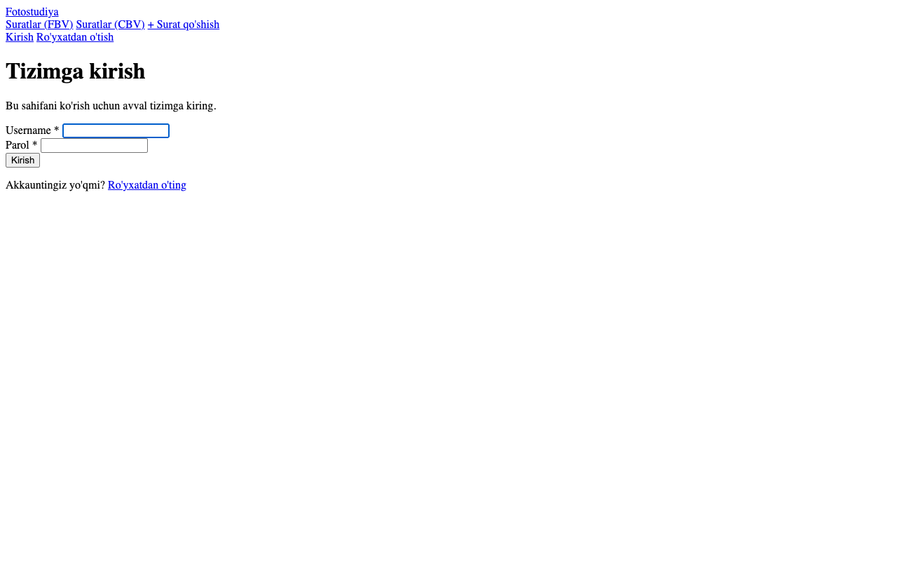
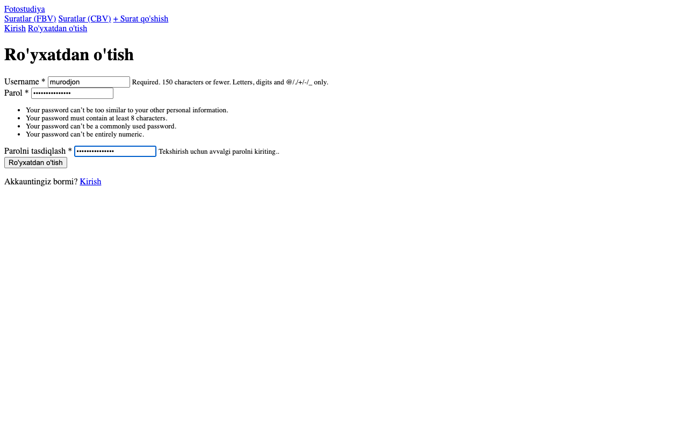
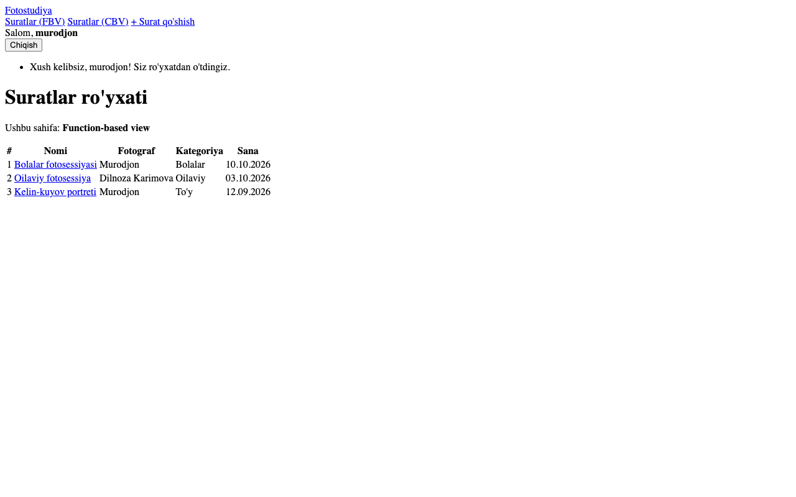
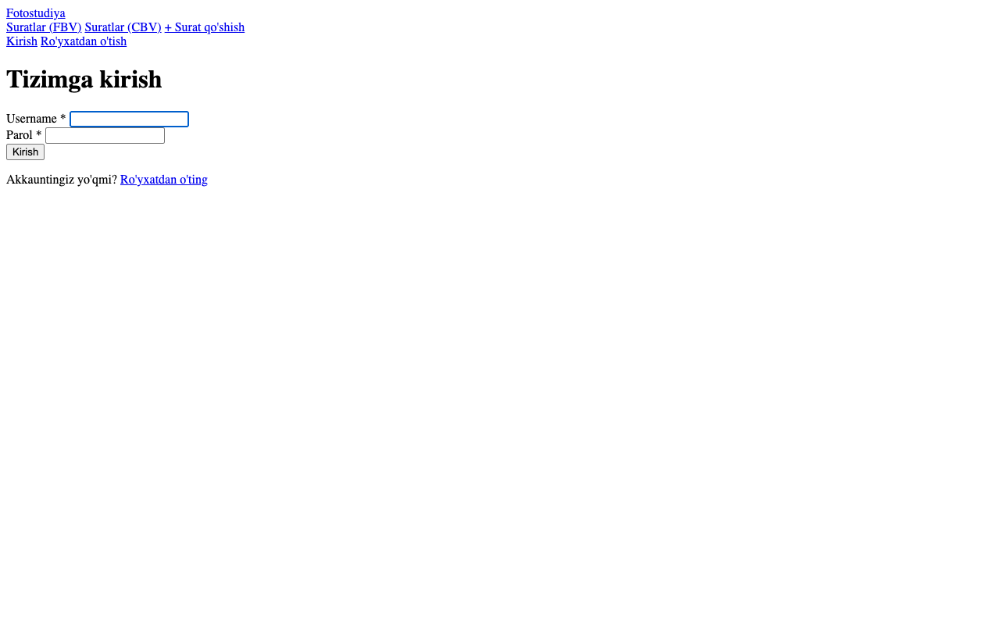
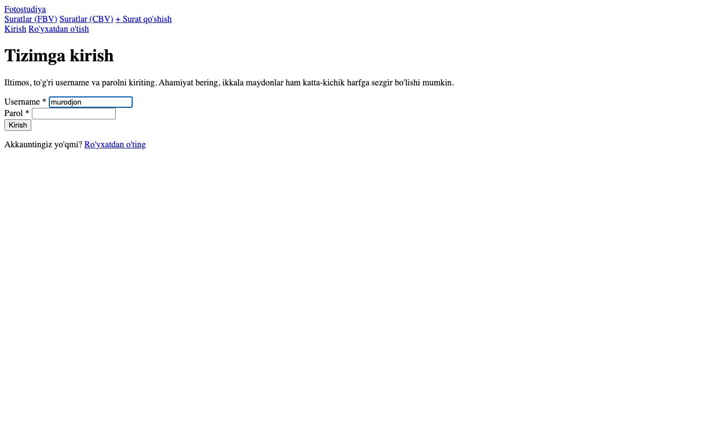
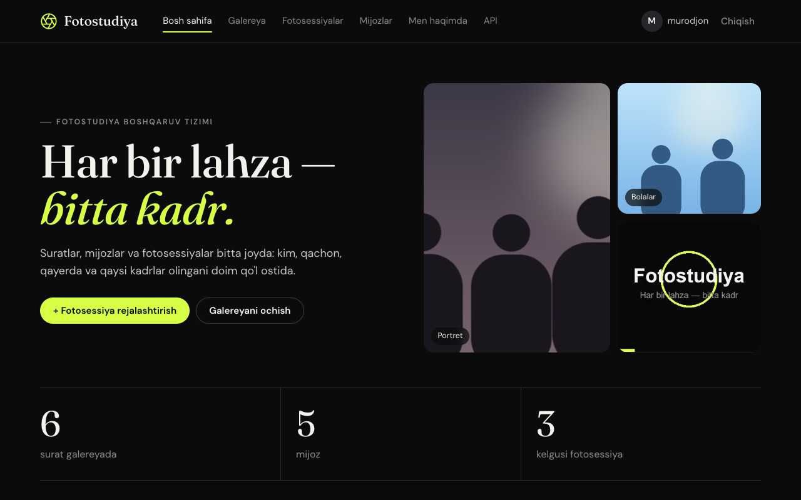

# 8-hafta — Django Authentication

**Holat:** ✅ bajarildi · **Commit:** `22166f2`

---

## Nazariy qism

### 1-topshiriq — Autentifikatsiya va session

Autentifikatsiya — foydalanuvchi kimligini tekshirish: login va parol to'g'ri bo'lsa, tizim uni taniydi.
Login muvaffaqiyatli bo'lgach, Django serverda **session** yaratadi va brauzerga `sessionid` cookie'sini yuboradi. Keyingi har bir so'rovda brauzer shu cookie'ni qaytaradi va Django `request.user` orqali foydalanuvchini qayta taniydi.
Logout qilinganda session o'chiriladi.

### 2-topshiriq — `@login_required`

`@login_required` dekoratori view'ni faqat tizimga kirgan foydalanuvchilar uchun ochiq qiladi.
Login qilmagan odam bu sahifani ochmoqchi bo'lsa, u `LOGIN_URL` ga (`/accounts/login/?next=/photos/`) yo'naltiriladi va kirgandan keyin o'sha sahifaga qaytariladi.
Bu yopiq ma'lumotlarni (mijozlar, fotosessiyalar) begona odamlardan himoya qiladi.

---

## Amaliy qism

### 3-topshiriq — Ro'yxatdan o'tish (UserCreationForm)

[`photostudio/views.py:268`](../photostudio/views.py):

```python
def register(request):
    if request.method == 'POST':
        form = UserCreationForm(request.POST)
        if form.is_valid():
            user = form.save()
            login(request, user)          # ro'yxatdan o'tgach avtomatik kiritiladi
            messages.success(request, ...)
            return redirect('photostudio:photo_list')
    else:
        form = UserCreationForm()
    return render(request, 'registration/register.html', {'form': form})
```

URL: `accounts/register/` — [`photostudio/urls.py:34`](../photostudio/urls.py)
Template: [`templates/registration/register.html`](../templates/registration/register.html)

### 4-topshiriq — Login va Logout (LoginView / LogoutView)

[`config/urls.py`](../config/urls.py):

```python
path('accounts/login/', auth_views.LoginView.as_view(), name='login'),
path('accounts/logout/', auth_views.LogoutView.as_view(), name='logout'),
```

- Login template: [`templates/registration/login.html`](../templates/registration/login.html)
- Logout — Django 5+ da faqat **POST** bilan ishlaydi, shuning uchun `base.html` da "Chiqish" oddiy havola emas, `` li kichik forma.
- Sozlamalar — [`config/settings.py:143`](../config/settings.py): `LOGIN_URL`, `LOGIN_REDIRECT_URL`, `LOGOUT_REDIRECT_URL`.

### 5-topshiriq — Sahifani himoyalash

- FBV: `@login_required` — [`views.py:60`](../photostudio/views.py) (`photo_list`), shuningdek `photo_detail`, `photo_create`, `photo_update`.
- CBV: `LoginRequiredMixin` — `PhotoListView` va 14-haftadagi barcha mijoz/fotosessiya view'lari.

---

## Darsda qanday ko'rsatish

1. Chiqib turgan holatda <http://127.0.0.1:8000/photos/> ni oching → login sahifasiga yo'naltiradi (`?next=/photos/`).
2. "Ro'yxatdan o'tish" → yangi foydalanuvchi yarating → avtomatik kiradi va ro'yxat ochiladi.
3. "Chiqish" → keyin noto'g'ri parol bilan kirib ko'ring → xato xabari.
4. To'g'ri login bilan kiring.

**Tayyor akkauntlar:**

| Login | Parol | Roli |
|---|---|---|
| `admin` | `Studio2026!` | administrator (superuser) |
| `murodjon` | `Fotostudiya2026` | ro'yxatdan o'tish sahifasi orqali yaratilgan; keyinroq `Xodimlar` guruhiga qo'shilgan ([qoshimcha.md](qoshimcha.md)) |

> **Eslatma:** login (username) katta-kichik harfga qaramaydi — `Murodjon`, `MURODJON` va `murodjon` bir xil ishlaydi
> ([`photostudio/backends.py`](../photostudio/backends.py), `AUTHENTICATION_BACKENDS` — `config/settings.py`).
> **Parol esa aniq yozilishi shart:** `Fotostudiya2026` (bosh harf katta F).

## Natija







