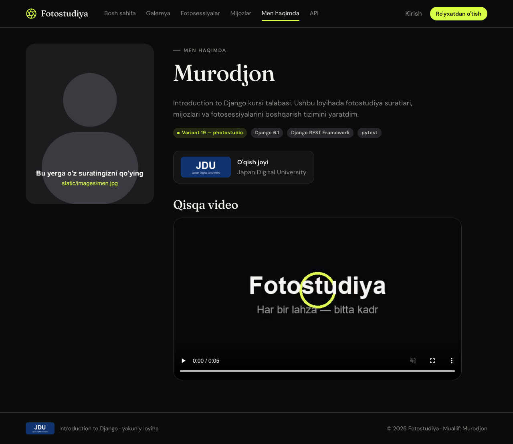
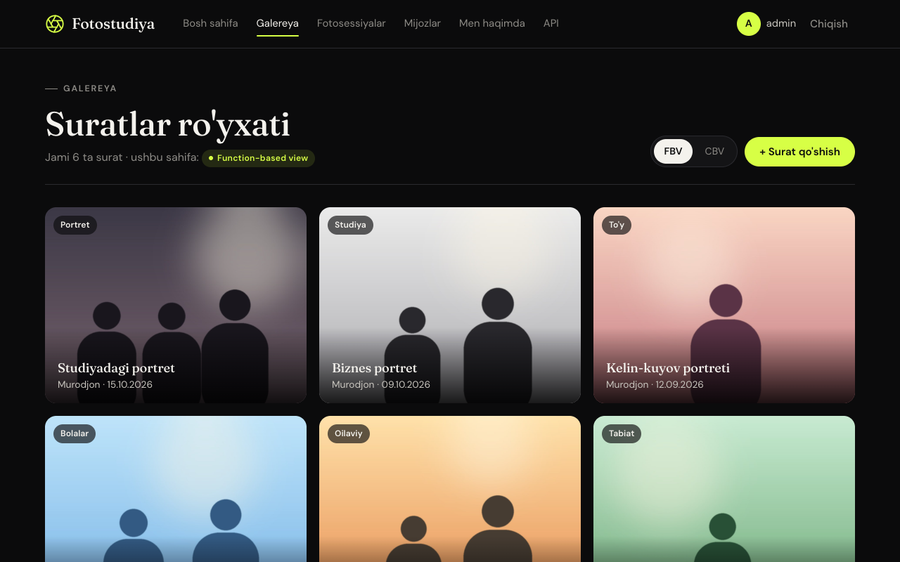
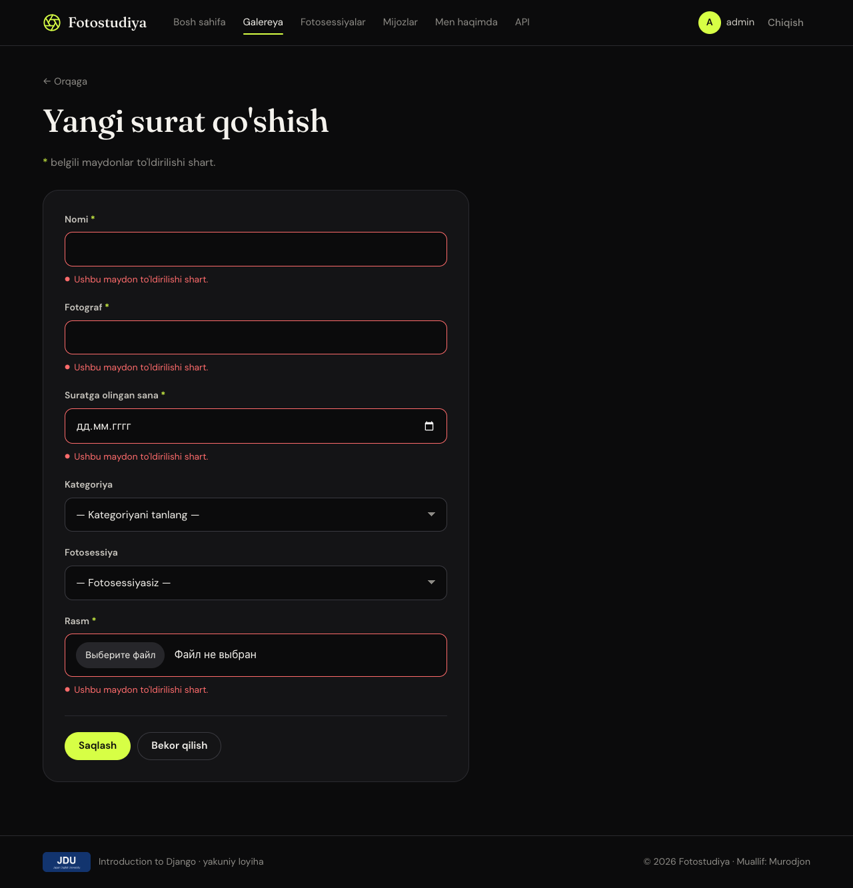

# 10-hafta — Django Static Files

**Holat:** ✅ bajarildi · **Commit:** `250cb7c`

> ⚠️ **SIZ BAJARISHINGIZ KERAK BO'LGAN ISH:** hozir `static/images/men.jpg` va `static/images/jdu_logo.png` —
> **vaqtinchalik (placeholder) rasmlar**, `static/video/intro.mp4` esa men yaratgan 5 soniyalik namuna video.
> O'zingizning suratingiz, videongiz va JDU'ning haqiqiy logotipini **aynan shu nomlar bilan** shu papkalarga
> almashtirib qo'ying. Kodni o'zgartirish shart emas. Fayl nomi boshqacha bo'lsa,
> [`about.html`](../photostudio/templates/photostudio/about.html) dagi yo'lni ham o'zgartiring.

---

## Nazariy qism

### 1-topshiriq — Static fayllar

Static fayllar — o'zgarmaydigan, server ularni "boricha" beradigan fayllar: CSS, JavaScript, rasmlar (logotip), video, shriftlar.
Ular saytning ko'rinishi va bezagi uchun kerak. Foydalanuvchi yuklagan fayllardan (MEDIA, 11-hafta) farqi shuki, static fayllarni dasturchi o'zi qo'yadi.
Django ularni `` va `` teglari orqali sahifaga ulaydi.

### 2-topshiriq — `STATICFILES_DIRS`

Odatda Django static fayllarni faqat har bir ilovaning ichidagi `static/` papkadan qidiradi.
`STATICFILES_DIRS` Django'ga qo'shimcha papkalarni ko'rsatadi, masalan loyiha ildizidagi umumiy `static/` papkani. U yerda butun saytga tegishli CSS va logotip saqlanadi.
`STATIC_ROOT` esa `collectstatic` buyrug'i hamma static fayllarni serverga chiqarish uchun yig'adigan papka.

---

## Amaliy qism

### 3-topshiriq — Static papkani sozlash

[`config/settings.py:131`](../config/settings.py):

```python
STATIC_URL = 'static/'
# 10-hafta: loyiha darajasidagi static/ papkasi (CSS, rasm, video)
STATICFILES_DIRS = [BASE_DIR / 'static']
# collectstatic shu papkaga yig'adi (serverga joylashda kerak bo'ladi)
STATIC_ROOT = BASE_DIR / 'staticfiles'
```

Papka tuzilmasi:

```
static/
├── css/style.css          ← butun sayt dizayni
├── images/men.jpg         ← shaxsiy surat (ALMASHTIRING)
├── images/jdu_logo.png    ← JDU logotipi (ALMASHTIRING)
└── video/intro.mp4        ← qisqa video (xohlasangiz almashtiring)
```

### 4-topshiriq — Rasm va videoni ko'rsatish

"Men haqimda" sahifasi: [`photostudio/templates/photostudio/about.html`](../photostudio/templates/photostudio/about.html), URL `/about/`.

```django



<video controls muted preload="metadata">
    <source src="" type="video/mp4">
</video>
```

JDU logotipi saytning har bir sahifasida, sarlavhadagi brand qismida ham bor ([`templates/base.html`](../templates/base.html)). Video bosh sahifada ham ishlatilgan.

### 5-topshiriq — CSS bilan bezash

[`templates/base.html`](../templates/base.html):

```django

<link rel="stylesheet" href="">
```

[`static/css/style.css`](../static/css/style.css) — **"Darkroom" dizayni**: qorong'i fon, yorqin laym (`#d7ff45`) urg'u rangi,
sarlavhalar uchun *Fraunces* (serif), matn uchun *DM Sans* shrifti (Google Fonts, internet bo'lmasa tizim shriftlari ishlatiladi).
Ichida: rang o'zgaruvchilari (`:root`), yopishqoq (sticky) sarlavha, masonry galereya (`columns`), sana bloklari bilan ro'yxatlar,
forma va xato uslublari, telefon ekrani uchun `@media` qoidalari.

---

## Darsda qanday ko'rsatish

1. <http://127.0.0.1:8000/about/> — surat, JDU logotipi va video (play tugmasini bosing).
2. `settings.py` dagi `STATIC_URL` / `STATICFILES_DIRS` ni ko'rsating.
3. `static/` papkani va `about.html` dagi `` teglarini ko'rsating.
4. Taqqoslash uchun 4-hafta skrinshotini (CSS'siz) va hozirgi ko'rinishni ko'rsatish mumkin.

## Natija




