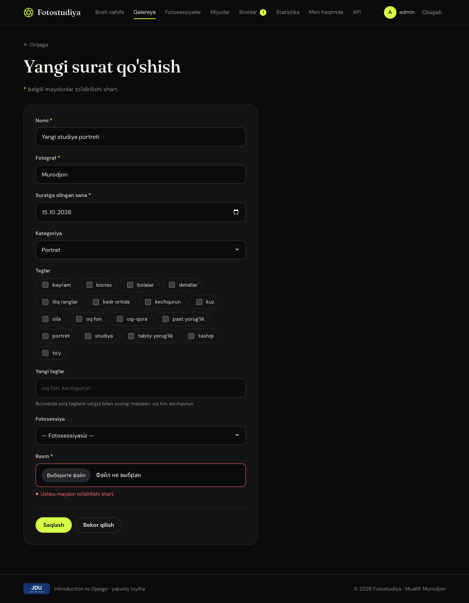
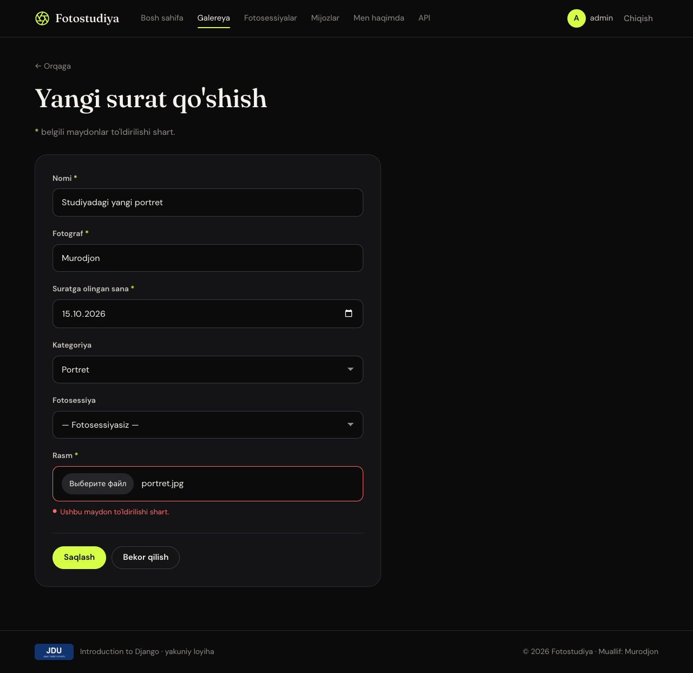
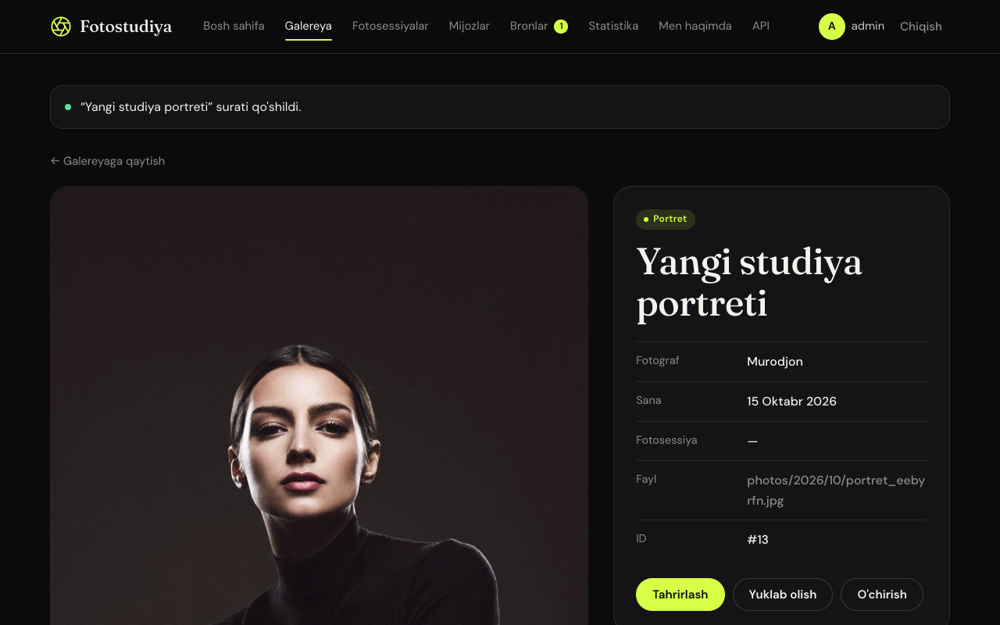
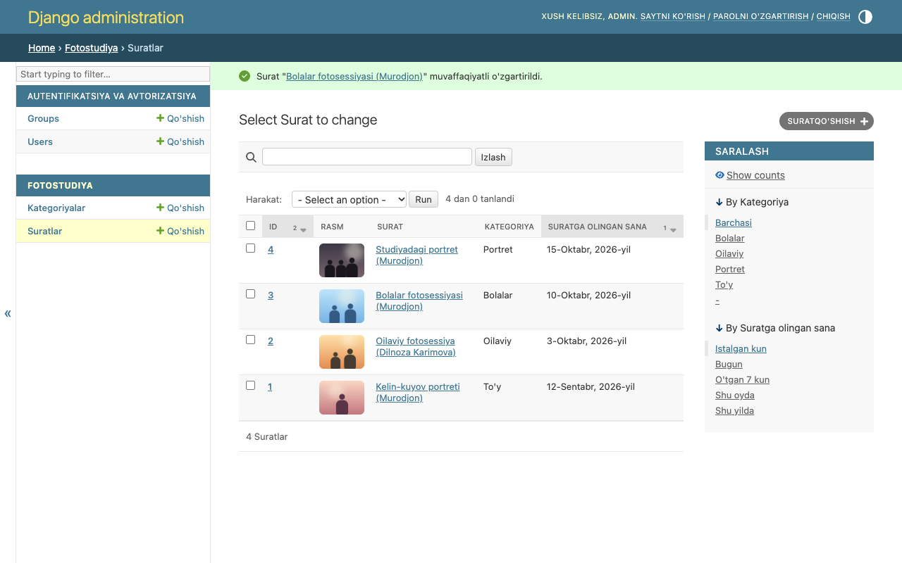
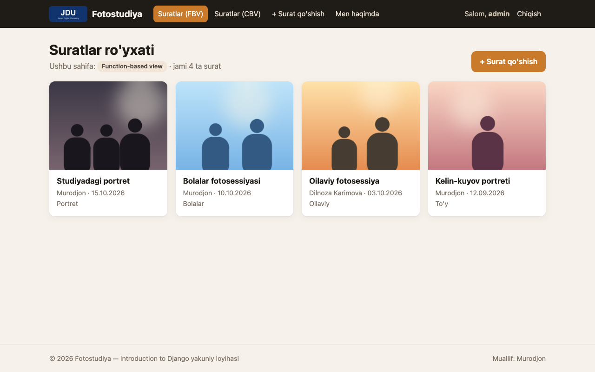

# 11-hafta — Django File Uploads

**Holat:** ✅ bajarildi · **Commit:** `d0b5371`

Variant 19: `Photo` — `title, photographer, date, image`.

---

## Nazariy qism

### 1-topshiriq — FileField va ImageField

`FileField` — istalgan faylni (PDF, Word, ZIP...) saqlash uchun maydon.
`ImageField` — `FileField` ning rasm uchun maxsus turi: yuklangan fayl haqiqatan rasm ekanini tekshiradi (Pillow kutubxonasi orqali) va rasmning eni/bo'yini bilish imkonini beradi.
Bazada ikkalasi ham faylning o'zini emas, faqat **yo'lini** (masalan `photos/2026/10/toy.jpg`) saqlaydi.

### 2-topshiriq — MEDIA sozlamalari

`MEDIA_ROOT` — foydalanuvchi yuklagan fayllar diskda **qaysi papkaga** saqlanishi (bizda `media/`).
`MEDIA_URL` — shu fayllar brauzerda **qaysi manzil** orqali ochilishi (bizda `/media/...`).
Static fayllardan farqi: media fayllarni foydalanuvchilar yuklaydi va ular git'ga qo'shilmaydi.

---

## Amaliy qism

### 3-topshiriq — Rasm maydoni qo'shish

```bash
pip install pillow       # ImageField uchun kerak
```

[`photostudio/models.py:136`](../photostudio/models.py):

```python
# 11-hafta: rasm fayli media/photos/YYYY/MM/ papkasiga saqlanadi
image = models.ImageField("Rasm", upload_to='photos/%Y/%m/', blank=True)
```

Migratsiya: [`0003_photo_image.py`](../photostudio/migrations/0003_photo_image.py).
`blank=True` — rasm qo'shilishidan oldin yaratilgan eski yozuvlar xato bermasligi uchun.
Yangi surat qo'shishda esa forma rasmni **majburiy** qiladi (`PhotoForm.__init__`).

### 4-topshiriq — Yuklash formasi va view

ModelForm — [`photostudio/forms.py:17`](../photostudio/forms.py) (`fields` ichida `'image'`).

View — [`photostudio/views.py:161`](../photostudio/views.py):

```python
form = PhotoForm(request.POST, request.FILES)
```

Template — [`form.html`](../photostudio/templates/photostudio/form.html):

```django
<form method="post" enctype="multipart/form-data" class="form-card" novalidate>
```

### 5-topshiriq — Faylni sahifada ko'rsatish

[`config/settings.py:154`](../config/settings.py):

```python
MEDIA_URL = 'media/'
MEDIA_ROOT = BASE_DIR / 'media'
```

[`config/urls.py`](../config/urls.py) — DEBUG rejimida media fayllarni Django'ning o'zi beradi:

```python
if settings.DEBUG:
    urlpatterns += static(settings.MEDIA_URL, document_root=settings.MEDIA_ROOT)
```

[`photo_detail.html`](../photostudio/templates/photostudio/photo_detail.html):

```django

```

Admin panelda ham kichik rasm (thumbnail) ustuni qo'shildi — [`photostudio/admin.py`](../photostudio/admin.py).

---

## Darsda qanday ko'rsatish

1. "Suratlar" → "+ Surat qo'shish".
2. Avval rasmsiz saqlab ko'ring → "Ushbu maydon to'ldirilishi shart."
3. Rasm tanlab saqlang → detail sahifada rasm ko'rinadi.
4. Loyiha papkasida `media/photos/2026/10/` ichida fayl paydo bo'lganini ko'rsating.
5. Rasm ustida o'ng tugma → "Rasm manzilini nusxalash" → `/media/photos/...` ekanini ko'rsating.

## Natija






