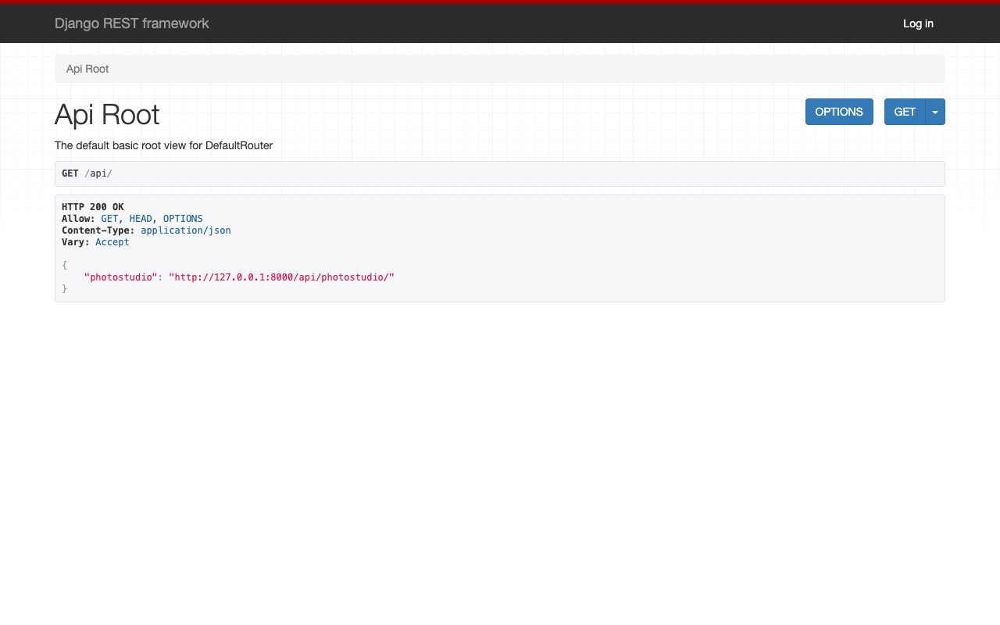
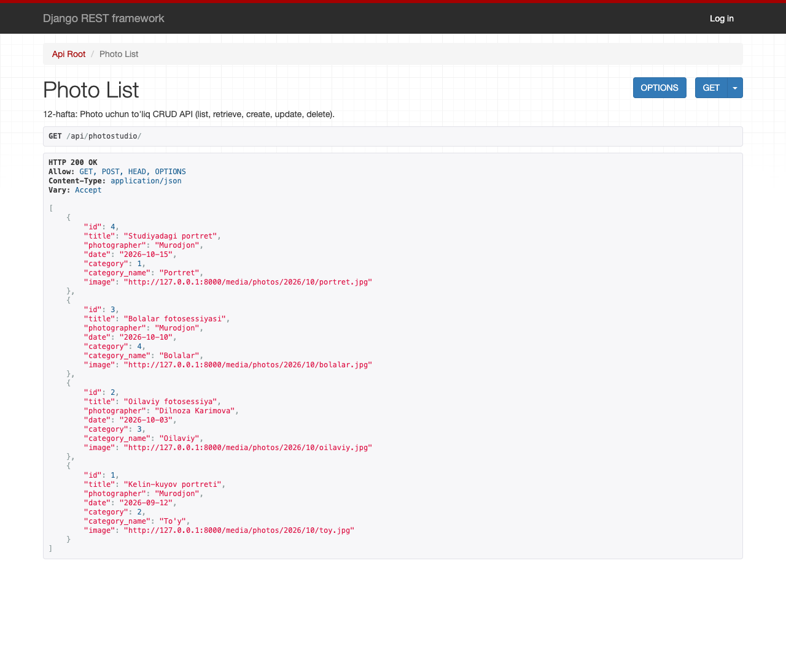
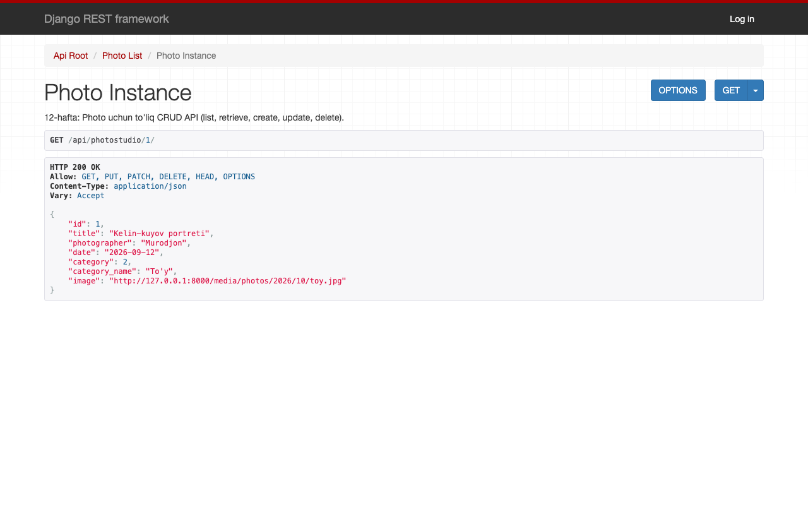

# 12-hafta — Django REST Framework (DRF)

**Holat:** ✅ bajarildi · **Commit:** `1dcf208`

Variant 19: endpoint nomi — **`photostudio`**, model — `Photo`.

---

## Nazariy qism

### 1-topshiriq — API nima

API (Application Programming Interface) — ikki dastur bir-biri bilan ma'lumot almashadigan "kelishuv".
Bizning REST API'miz HTML sahifa o'rniga **JSON** qaytaradi. Shu sababli bitta backend'dan mobil ilova, React sayt yoki Telegram bot ham foydalana oladi.
Masalan, `GET /api/photostudio/` hamma suratlarni, `GET /api/photostudio/1/` esa bitta suratni JSON ko'rinishida beradi.

### 2-topshiriq — Serializer

Serializer model obyektini JSON'ga aylantiradi (**serialization**) va kelgan JSON'ni tekshirib, model obyektiga aylantiradi (**deserialization**).
Bu jarayon Django formalariga o'xshaydi: serializer ham maydonlarni validatsiya qiladi va `save()` qila oladi.
`ModelSerializer` maydonlarni modeldan avtomatik oladi.

---

## Amaliy qism

### 3-topshiriq — DRF o'rnatish

```bash
pip install djangorestframework
```

[`config/settings.py:53`](../config/settings.py) → `INSTALLED_APPS` ga `'rest_framework'`.

Ruxsatlar — 12-haftada `IsAuthenticatedOrReadOnly` edi: o'qish hammaga, yozish faqat login qilganlarga.

> 🔒 **Keyinchalik o'zgartirildi.** Mijoz kabineti qo'shilgach ([qoshimcha.md](qoshimcha.md)), API orqali har kim
> mijozlarning barcha suratlarini ko'ra olardi. Shuning uchun API **faqat xodimlarga** yopildi —
> [`photostudio/permissions.py`](../photostudio/permissions.py):

```python
REST_FRAMEWORK = {
    'DEFAULT_PERMISSION_CLASSES': [
        'photostudio.permissions.IsEmployee',
    ],
}
```

```python
class IsEmployee(BasePermission):
    message = "Bu API faqat fotostudiya xodimlari uchun."

    def has_permission(self, request, view):
        if not request.user.is_authenticated:
            raise NotAuthenticated("Bu API faqat fotostudiya xodimlari uchun. Avval xodim akkaunti bilan tizimga kiring.")
        return is_employee(request.user)
```

| Kim | `/api/photostudio/` |
|---|---|
| mehmon | 403 — "Bu API faqat fotostudiya xodimlari uchun…" |
| mijoz (`aziza`) | 403 |
| xodim (`murodjon`), admin | 200 — ro'yxat, qo'shish, tahrirlash, o'chirish |

### 4-topshiriq — Serializer va ViewSet

[`photostudio/serializers.py`](../photostudio/serializers.py):

```python
class PhotoSerializer(serializers.ModelSerializer):
    category_name = serializers.CharField(source='category.name', read_only=True, default=None)

    class Meta:
        model = Photo
        fields = ['id', 'title', 'photographer', 'date', 'category', 'category_name', 'image']
```

[`photostudio/api.py`](../photostudio/api.py):

```python
class PhotoViewSet(viewsets.ModelViewSet):
    queryset = Photo.objects.select_related('category')
    serializer_class = PhotoSerializer
```

### 5-topshiriq — Router va sinash

[`config/urls.py:12`](../config/urls.py):

```python
router = DefaultRouter()
router.register('photostudio', PhotoViewSet)

urlpatterns = [
    ...
    path('api/', include(router.urls)),
]
```

| Manzil | Natija |
|---|---|
| `GET /api/` | API ildizi (ro'yxat havolasi) |
| `GET /api/photostudio/` | barcha suratlar (JSON) |
| `GET /api/photostudio/1/` | bitta surat |
| login'siz yoki mijoz sifatida | `403 — Bu API faqat fotostudiya xodimlari uchun.` |

Terminal orqali sinov (12-haftadagi holat, API hali ochiq bo'lgan payt): [`terminal/week12_api_curl.txt`](terminal/week12_api_curl.txt)

```json
{
    "id": 1,
    "title": "Kelin-kuyov portreti",
    "photographer": "Murodjon",
    "date": "2026-09-12",
    "category": 2,
    "category_name": "To'y",
    "image": "http://127.0.0.1:8000/media/photos/2026/10/toy.jpg"
}
```

API testlari: [`tests/test_api.py`](../photostudio/tests/test_api.py).

---

## Darsda qanday ko'rsatish

0. Avval saytga **`admin`** (yoki `murodjon`) bilan kiring — API faqat xodimlar uchun. Menyuda **API** havolasi paydo bo'ladi.
1. <http://127.0.0.1:8000/api/photostudio/> — DRF'ning brauzer interfeysida ro'yxat.
   (`/api/` — faqat "kirish eshigi", manzillar ro'yxatini ko'rsatadi.)
2. <http://127.0.0.1:8000/api/photostudio/1/> — bitta obyekt.
3. (Ixtiyoriy) Sahifa pastidagi forma bilan POST qilib yangi surat qo'shish.
4. Chiqib, yana `/api/photostudio/` ni oching → 403: begona odam ko'ra olmaydi.

> 💡 Chrome sahifani avtomatik tarjima qilsa ("Api ildizi", "OLING"), manzil satridagi tarjima belgisidan **Show original** ni tanlang.
4. `serializers.py`, `api.py` va `config/urls.py` dagi `router.register('photostudio', PhotoViewSet)` ni ko'rsating.

## Natija




