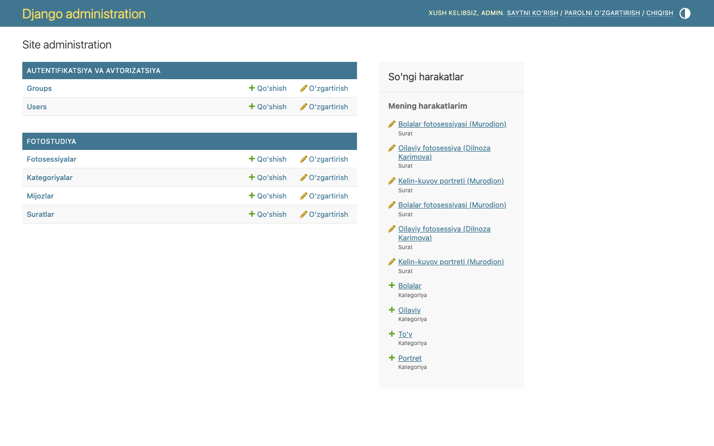
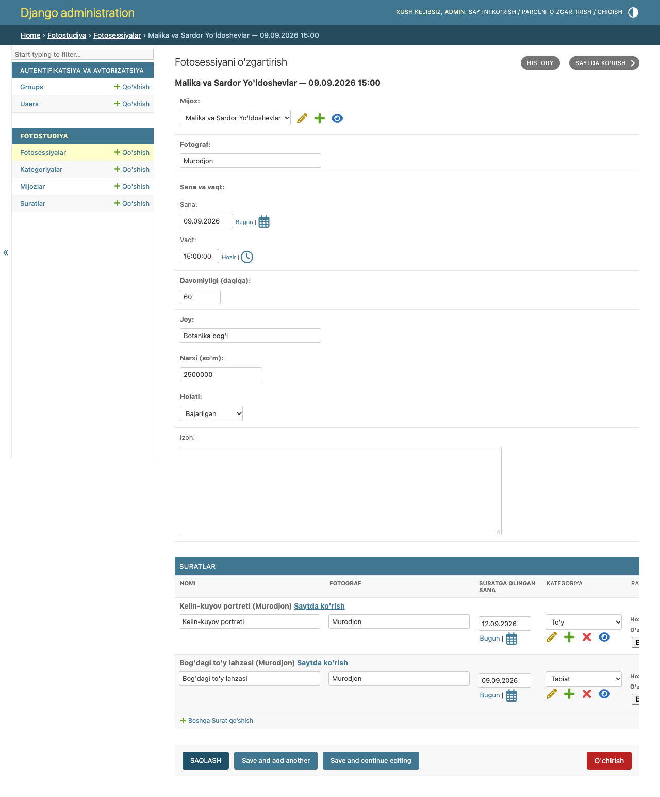
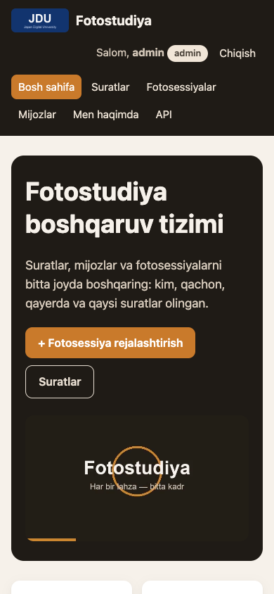
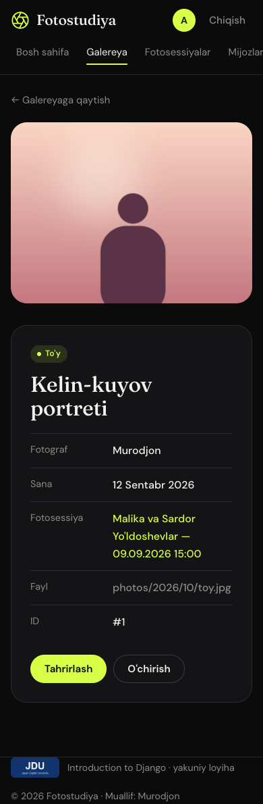

# 15-hafta — Yakuniy loyiha (Final Project)

**Holat:** ✅ loyiha tayyor va GitHub'da: <https://github.com/murodjon-coder/djangoproject> · ⚠️ shaxsiy surat va JDU logotipini almashtirish sizda qoldi (pastda)

---

## 1. Majburiy talablar (5 ball) — tekshiruv ro'yxati

| Talab | Holat | Qayerda / dalil |
|---|---|---|
| Kamida 2 ta bog'liq model (ForeignKey) | ✅ 4 ta model, 3 ta ForeignKey | `Photo→Category`, `Photo→Session`, `Session→Client` — [`models.py`](../photostudio/models.py) |
| To'liq CRUD: ro'yxat, detail, qo'shish, tahrirlash | ✅ + o'chirish | Surat, Mijoz, Fotosessiya — [`views.py`](../photostudio/views.py), [`urls.py`](../photostudio/urls.py) |
| Kamida bitta forma | ✅ 3 ta ModelForm + UserCreationForm | [`forms.py`](../photostudio/forms.py) |
| Autentifikatsiya: ro'yxatdan o'tish, login/logout, himoyalangan sahifa | ✅ | [`week08.md`](week08.md) |
| Barcha modellar admin panelda | ✅ Category, Client, Session, Photo | [`admin.py`](../photostudio/admin.py) |
| Git + GitHub, `.gitignore` | ✅ GitHub: [murodjon-coder/djangoproject](https://github.com/murodjon-coder/djangoproject), 28 ta mazmunli commit, 5 ta branch + merge, `.gitignore` | [`week14.md`](week14.md#3-topshiriq--reja-va-git) |

## 2. Bonus ballar (+3) — hammasi bajarilgan

| Bonus | Holat | Qayerda |
|---|---|---|
| DRF API (ViewSet) | ✅ `/api/photostudio/` | [`week12.md`](week12.md) |
| pytest bilan kamida 2 ta test | ✅ **74 ta test, hammasi passed** | [`week13.md`](week13.md) |
| Static fayllar bilan bezatilgan sahifalar | ✅ to'liq CSS dizayn, telefonga moslashgan | [`week10.md`](week10.md) |

## 3. Taqdimotdan oldin qilinadigan ishlar ✔️

- [ ] `static/images/men.jpg` — **o'z suratingiz** bilan almashtiring
- [ ] `static/images/jdu_logo.png` — **JDU'ning haqiqiy logotipi** bilan almashtiring
- [ ] (ixtiyoriy) `static/video/intro.mp4` — o'z videongiz
- [x] GitHub'ga push qilingan — https://github.com/murodjon-coder/djangoproject
- [ ] `admin` parolini o'zgartiring (`python manage.py changepassword admin`) yoki shu parolni eslab qoling
- [ ] Taqdimotdan oldin: `cd ~/Django/photostudio && source ../photostudio_venv/bin/activate && python manage.py runserver`
- [ ] `pytest` ni bir marta ishga tushirib ko'ring

---

## 4. Taqdimot ssenariysi (5–7 daqiqa)

**0:00–0:45 — Kirish.**
"Mening loyiham — Fotostudiya boshqaruv tizimi (19-variant). Fotostudiya xodimlari suratlar, mijozlar va fotosessiyalarni bir joyda boshqaradi."

**0:45–1:45 — Tuzilma (VS Code'da).**
- Loyiha: `config/` — sozlamalar; ilova: `photostudio/`.
- Modellar: `Category`, `Client`, `Session`, `Photo`. Bog'lanishlar: mijozning ko'p fotosessiyasi bor, har bir fotosessiyada ko'p surat olinadi, har bir surat bitta kategoriyada.
- `README.md` dagi sxema: `Client 1──* Session 1──* Photo *──1 Category`.

**1:45–4:30 — Jonli namoyish (brauzerda).**
1. Bosh sahifa (mehmon) → "Kirish" → `admin`.
2. Mijoz qo'shish (avval noto'g'ri telefon → xato, keyin to'g'ri).
3. Shu mijozga fotosessiya → sessiyaga rasm yuklab surat qo'shish.
4. Suratni tahrirlash → o'chirish.
5. "Chiqish" → `murodjon` bilan kirish → o'chirish tugmasi yo'q, `/photos/1/delete/` → 403.
6. `/api/photostudio/` — API (admin bilan kirgan holda; mehmonga 403).
7. `/admin/` — barcha modellar.

**4:30–5:30 — Testlar va Git.**
Terminalda `pytest` → 74 passed. `git log --oneline --graph` → har hafta alohida commit, 14-hafta branch'i va merge. GitHub sahifasi.

**5:30–6:30 — Eng katta qiyinchilik** (pastga qarang).

**6:30–7:00 — Savollar.**

---

## 5. Duch kelgan qiyinchiliklar va yechimlar (taqdimot uchun)

1. **Nom to'qnashuvi (eng kattasi).** Loyiha `photostudio` deb yaratilgan edi, jadval bo'yicha ilova ham `photostudio` bo'lishi kerak edi. `startapp photostudio` "conflicts with the name of an existing Python module" xatosini berdi.
   **Yechim:** loyihaning sozlamalar papkasini `config/` deb qayta nomladim va `manage.py`, `settings.py`, `wsgi.py`, `asgi.py` dagi yo'llarni yangiladim. Endi loyiha sozlamalari `config` da, ilova esa `photostudio` da.
2. **Logout ishlamadi.** Django 5+ da `LogoutView` faqat POST qabul qiladi, oddiy `<a href>` havolasi 405 xato beradi.
   **Yechim:** "Chiqish"ni `` li kichik POST forma qildim.
3. **Rasm qo'shilgandan keyin eski yozuvlar.** `ImageField` qo'shganda bazada rasmsiz yozuvlar bor edi.
   **Yechim:** modelda `blank=True`, formada esa yangi surat uchun rasm majburiy (`PhotoForm.__init__`).
4. **Test sahifaga kira olmadi.** Ro'yxat `@login_required` bo'lgani uchun test 302 oldi.
   **Yechim:** `client.force_login(user)` bilan `logged_client` fixture yozdim.

---

## 6. Ehtimoliy savollar va javoblar

| Savol | Javob |
|---|---|
| `select_related` va `prefetch_related` farqi? | `select_related` — ForeignKey/OneToOne uchun SQL JOIN (bitta so'rov). `prefetch_related` — teskari va ManyToMany bog'lanishlar uchun alohida so'rov, Python'da birlashtiriladi. |
| Nega `on_delete=SET_NULL` va `CASCADE`? | Kategoriya o'chirilsa, suratlar qolishi kerak → `SET_NULL`. Mijoz o'chirilsa, uning fotosessiyalari ma'nosiz → `CASCADE`. Sessiya o'chirilsa, suratlar qoladi → `SET_NULL`. |
| `MEDIA` va `STATIC` farqi? | STATIC — dasturchi qo'ygan (CSS, logotip), MEDIA — foydalanuvchi yuklagan (surat rasmlari). |
| CSRF token nima uchun? | Boshqa sayt foydalanuvchi nomidan POST yubormasligi uchun. `CsrfViewMiddleware` tekshiradi. |
| FBV yoki CBV — qaysi biri yaxshi? | Ikkalasi ham ishlatilgan: suratlar uchun FBV (mantiq aniq ko'rinadi), mijoz va sessiyalar uchun CBV (kod qisqa). |
| Middleware qanday ishlaydi? | Har bir so'rovni view'dan oldin va keyin "o'rab oladi". Mening `RequestTimingMiddleware` vaqtni o'lchab, terminalga chiqaradi. |
| Parollar qanday saqlanadi? | Ochiq holda emas, xesh ko'rinishida (PBKDF2). Admin ham parolni ko'ra olmaydi. |
| `db.sqlite3` nega GitHub'da yo'q? | `.gitignore` da: unda foydalanuvchilar va mijozlar ma'lumoti bor. Yangi joyda `migrate` + `seed_demo` bilan qayta yaratiladi. |

---

## Natija

Telefon ekranida:

| | |
|---|---|
|  |  |
